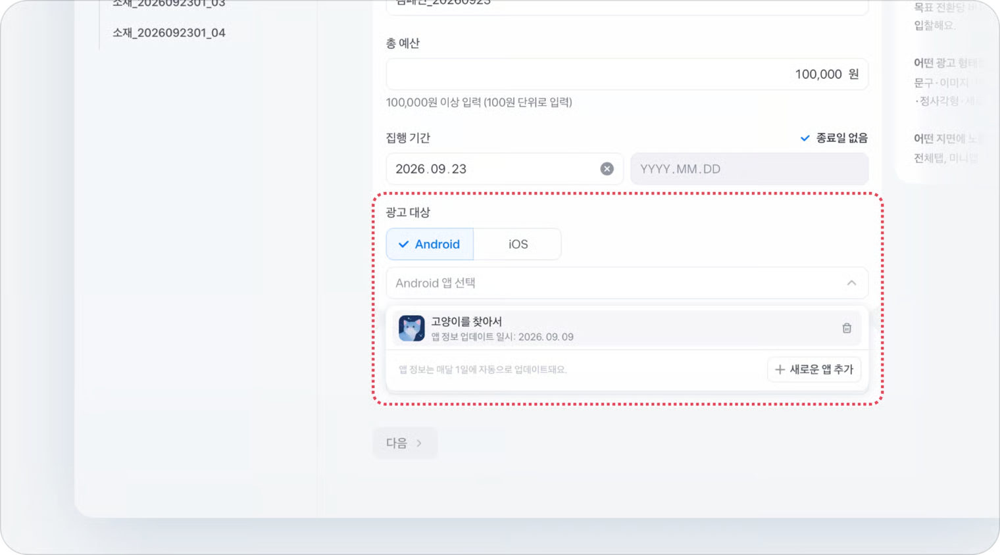

---
layout:
  width: default
  title:
    visible: true
  description:
    visible: false
  tableOfContents:
    visible: true
  outline:
    visible: true
  pagination:
    visible: true
  metadata:
    visible: true
  tags:
    visible: true
  actions:
    visible: true
  anchors:
    visible: true
---

# 앱 설치 유도하기

앱 설치 유도하기는 유저의 **앱 설치와 실행**을 이끌어내는 토스 네이티브 광고예요. 이 문서를 따라 하면 앱 설치 유도하기 캠페인을 만들고, 광고세트까지 설정해 광고를 집행할 준비를 마칠 수 있어요.

## 앱 설치 유도하기란? 

앱 설치 유도하기는 앱 설치·실행 전환을 목적으로 하는 광고로, 유저가 광고를 통해 아웃랜딩으로 이동할 때 과금돼요. 브릿지 페이지(앱 소개 화면)로 이동해요. 소개 화면은 소재를 등록할 때 직접 만들거나, 광고 대상으로 선택한 앱의 앱마켓 정보로 채울 수 있어요.&#x20;

### 광고를 만드는 3단계 구조

토스애즈에서 광고를 집행하려면 **캠페인 > 광고세트 > 소재** 3단계를 등록해야 해요.

| 단계       | 설정하는 것                                     |
| -------- | ------------------------------------------ |
| **캠페인**  | 광고 목표, 집행 기간, 총 예산을 설정하고 하위 광고세트·소재를 관리해요. |
| **광고세트** | 일 예산, 입찰 방식, 타겟, 노출 일정을 설정해요.              |
| **소재**   | 유저에게 실제로 보이는 이미지·문구 등 크리에이티브를 설정해요.        |


소재를 만드는 방법은 [앱 설치 소재 가이드](creative.md)에서 따로 안내하고 있어요. 이 문서에서는 캠페인과 광고세트까지 다뤄요.


#### 광고 대상이란?

광고 대상은 광고할 앱이에요. 캠페인에서 **OS(Android 또는 iOS)**&#xB97C; 고른 뒤, 광고할 앱을 하나 선택해요.

* 앱은 **새로운 앱 추가**로 등록해요. 한 번 추가한 앱은 광고계정에 저장돼 다른 캠페인에서도 다시 선택할 수 있어요. 최대 300개까지 추가할 수 있어요.
* 앱을 추가하면 토스가 앱마켓에 공개된 앱 정보(앱 로고, 앱 이름, 스크린샷 등)를 수집해요. 소개 화면을 추가하면 이 정보로 자동으로 채워져요.
* 앱 정보는 한 달 주기로, 매달 1일에 자동으로 업데이트돼요. 이미 저장한 소개 화면은 바뀌지 않아요.


**Android와 iOS에 모두 광고하려면 캠페인을 OS별로 만들어 주세요.** \
캠페인 하나에는 앱 하나만 선택할 수 있어요. 같은 앱을 두 OS에 광고한다면 Android 앱과 iOS 앱을 각각 추가하고, 캠페인도 두 개 만들어요.


## 시작하기 전 준비하기 

* **전환 및 추적 연동을 완료해주세요.**
  * 앱 설치 유도하기는 앱 설치·실행 성과를 측정하기 위해 앱 성과 측정 도구(MMP)를 이용하는 [앱 광고 성과 측정 연동(MAT)](../../tracking/mat/)이 필수예요. 캠페인을 만들기 전에 먼저 완료해 주세요.
* **미리 준비할 정보**
  * **앱마켓 URL**: 캠페인에서 광고 대상 앱을 추가할 때 써요.
    * Android는 구글 플레이스토어 URL, iOS는 앱스토어 URL을 준비해주세요. 트래킹 링크나 유니버설 링크는 쓸 수 없어요.
    * 앱을 처음 추가할 때 앱 정보 수집 및 활용 동의를 받아요. 동의를 철회하려면 광고 대상에 등록된 앱을 삭제하면 돼요.
  * **랜딩 URL 2종**: 소재의 연결 페이지에서 써요.
    * 유니버설 링크&앱링크를 지원하는 전환 추적 가능한 랜딩 URL
    * 앱 스킴
  * **소재 정보**: 앱 로고, 한국어 앱 이름, 영어 앱 이름, 보조 문구
  * **광고 고지 문구**: 심의필이 필요한 업종이라면 준비해주세요. 소개 화면에 들어가는 문구로, 앱마켓 정보로는 채워지지 않아요.
  * URL과 소재는 소재 단계에서 입력하며, 규격은 [앱 설치 소재 가이드](creative.md)에서 안내하고 있어요.

## 캠페인 만들기 

1. 아래 두 방법 중 하나로 캠페인 생성 화면을 열어주세요.&#x20;
   1. 방법 1: 좌측 메뉴의 **광고 시작하기**를 누르고, 디스플레이에서 **앱 설치 유도하기**를 선택해요.
   2. 방법 2: 좌측 메뉴의 **디스플레이**를 누르고, 오른쪽 위 **캠페인 생성**을 눌러요.
2.  캠페인 목표에서 **앱 설치 유도하기**가 선택됐는지 확인해 주세요. 

    <figure><figcaption>
캠페인 목표에서 앱 설치 유도하기를 선택한 화면
</figcaption></figure>
3. 아래 캠페인 정보를 입력해주세요.

| 입력 항목          | 안내                                                                                                                                                              |
| -------------- | --------------------------------------------------------------------------------------------------------------------------------------------------------------- |
| **캠페인명**       | 관리하기 쉬운 이름으로 입력해주세요. 입력하지 않으면 `캠페인_생성일시`로 자동 저장돼요.                                                                                                              |
| **총 예산**       | 캠페인 집행 기간 동안 쓸 예산 한도예요. 100,000원 이상, 100원 단위로 입력해주세요.                                                                                                           |
| **집행 기간**      | 광고가 노출되는 전체 기간이에요. 종료일을 두지 않으려면 **종료일 없음**을 선택해주세요.                                                                                                             |
| **광고 대상**      | 광고할 앱의 OS(**Android** 또는 **iOS**)를 고르고, **Android 앱 선택**(iOS는 **iOS 앱 선택**)에서 앱을 골라주세요. 처음이라면 **새로운 앱 추가**로 앱을 등록해요. 아래 [광고 대상 앱 추가하기](./#undefined-1)를 참고해주세요. |
| **전환 및 추적 연동** | 연동을 마친 전환 추적 코드를 선택해주세요. 연동이 완료된 코드만 선택할 수 있어요.                                                                                                                 |

<figure><figcaption>
전환·추적 코드를 설정하는 화면
</figcaption></figure>

<figure><figcaption>
캠페인에서 광고 대상을 선택하는 화면
</figcaption></figure>

#### 광고 대상 앱 추가하기

<figure><figcaption></figcaption></figure>

1. **광고 대상**에서 **Android** 또는 **iOS**를 선택해주세요.
2. **Android 앱 선택**을 눌러 목록을 열고, **새로운 앱 추가**를 눌러주세요.
3. **구글 플레이스토어 URL**(iOS는 **앱스토어 URL**)을 입력하고 **추가**를 눌러주세요.
4. 앱 정보 수집 및 활용 동의 내용을 확인하고 **동의**를 눌러주세요.

앱을 추가하면 바로 앱 정보를 수집하기 시작해요. 기다리지 않고 광고세트와 소재 설정을 이어가도 돼요.

<table><thead><tr><th width="117.14813232421875">상태</th><th width="167.0740966796875">목록에 보이는 모습</th><th width="141.1851806640625">광고 대상으로 선택</th><th>할 일</th></tr></thead><tbody><tr><td>수집 중</td><td>앱 정보 수집중...</td><td>선택 가능</td><td>기다리지 않고 광고세트·소재 설정을 이어가도 돼요. 수집이 끝나면 앱 아이콘과 앱 이름으로 바뀌어요.</td></tr><tr><td>수집 완료</td><td>앱 아이콘과 앱 이름</td><td>선택 가능</td><td>소재 설정의 <strong>소개 화면</strong>에서 <strong>추가하기</strong>를 누르면 앱마켓 정보가 자동으로 채워져요.</td></tr><tr><td>수집 실패</td><td>사용할 수 없는 앱 + <strong>URL 수정</strong> 버튼</td><td>선택 불가능</td><td><strong>URL 수정</strong>을 눌러 구글 플레이스토어(또는 앱스토어) URL이 맞는지 확인하고 고쳐 주세요.</td></tr></tbody></table>

<figure><figcaption>
광고 대상 앱 목록에 보이는 상태(수집 중·수집 완료·수집 실패)
</figcaption></figure>


**이미 추가한 앱은 다시 추가할 수 없어요. 목록에서 기존 앱을 선택해주세요.**

목록에서 앱을 삭제할 수 있어요. 단, 이 앱을 선택한 캠페인 중 **노출이 켜진 캠페인이 있으면 삭제할 수 없어요.** 노출을 모두 끈 뒤 삭제해주세요.



**심사 제출 후에는 캠페인 목표, 전환·추적 코드, 광고 대상을 변경할 수 없어요.**

캠페인의 소재 중 하나라도 심사를 신청하면 광고 대상 앱을 바꿀 수 없으니, 심사 제출 전에 다시 확인해 주세요.


## 광고세트 만들기 

캠페인 하위에 광고세트를 만들어 예산, 입찰, 타겟 조건을 설정해요.

**일 예산**

하루 동안 집행할 예산을 설정해요. 캠페인 총 예산 한도 안에서 설정할 수 있고, 이미 집행된 금액보다 적게는 설정할 수 없어요.

**입찰 방식**

앱 설치 유도하기는 **목표 전환당 비용(tCPA)** 자동 입찰을 지원해요. 목표로 정한 전환당 비용을 달성하도록, 전환 가능성이 높은 유저에게 자동 입찰해요.


**자동 입찰은 학습 시간이 필요해요.**&#x20;

tCPA는 머신러닝이 전환 데이터를 학습하며 입찰을 최적화하는 방식이라, 최적화까지 최대 일주일 정도 걸릴 수 있어요. 학습 초기에는 비용이 일시적으로 목표보다 높아질 수 있지만, 점차 목표 비용에 가까워져요. 다만 목표 비용이 너무 낮으면 예산이 소진되지 않고 전환도 잘 모이지 않을 수 있으니, 이 경우 목표 비용을 조금 올려보세요.


<figure><figcaption>
앱 설치 유도하기 광고세트에서 목표 전환당 비용을 설정하는 화면
</figcaption></figure>

**타겟팅**

앱 설치 유도하기는 **오토 타겟팅**으로 운영돼요. 토스가 앱에 관심 가질 가능성이 높은 유저를 자동으로 찾아 노출해요.

* **오토 타겟팅**
  * 오토 타겟팅은 토스가 광고에 반응할 가능성이 높은 사용자를 자동으로 찾아 노출하는 방식이에요.
  * 연령·성별 등 세부 타겟을 직접 설정하지 않아도 되고, 기본적으로 전체 연령을 대상으로 해요.
  * 오토 타겟팅은 타겟을 자동으로 탐색하기 때문에, 예상 타겟 수는 미리 확인할 수 없어요.
  * **광고에서 제외할 대상 설정하기**
    * 오토 타겟팅을 사용할 때는, 광고를 노출하고 싶지 않은 대상을 제외할 수 있어요.
    * 연령, 성별, 고객 목록, OS를 기준으로 제외할 수 있어요. 이 기능은 오토 타겟팅에서만 제공해요.
    * OS는 광고 대상으로 선택한 앱의 OS에 맞춰 다른 OS가 자동으로 제외돼요. 바꿀 수 없어요.
      * Android 앱이라면 iOS가, iOS 앱이라면 Android가 제외돼요.
    * 제외하는 대상이 적을수록 토스가 더 많은 사용자를 탐색할 수 있어, 광고 성과를 높이는 데 도움이 돼요.


**공통 준수 사항 - 성인 타겟팅**

* 성인 타겟팅은 성인(만 19세 이상)에게만 노출해야 하는 업종이나 광고일 때 사용하는 설정이에요.
* 성인 타겟팅을 사용하면 만 19세 이상에게만 광고가 노출되고, 미성년자(만 14\~18세)에게는 노출되지 않아요.
* 주류·담배·전자담배·데이팅·게임(성인 등급) 등 미성년자 보호 정책에 해당하는 업종·소재는 성인 타겟팅을 반드시 사용해야 해요. 자세한 대상은 [성인 타겟팅 필수 업종·소재](../../review/industryguide.md) 가이드에서 확인할 수 있어요.
* 성인 타겟팅 설정 후 광고 심사를 신청하면 설정을 바꿀 수 없으니, 심사 신청 전에 꼭 확인해 주세요.


**노출 기간, 노출 시간**

* 노출 기간
  * 광고세트 노출 기간을 설정하실 수 있어요.
  * 캠페인 기간과 동일 옵션을 선택하실 경우 광고세트가 속한 캠페인의 기간과 동일하게 노출이 진행돼요.
  * 광고세트 노출 기간은 캠페인 집행 기간 이내로 설정할 수 있어요.
* 노출 시간
  * 상시 노출 값으로 기본 적용돼요.
  * 노출 시간대 설정을 클릭하실 경우 간단하게 노출 시간대를 설정할 수 있어요.
  * 요일별 시간대 설정을 클릭하실 경우 노출 요일과 시간을 설정할 수 있어요.

광고세트까지 설정했다면, [앱 설치 소재 가이드](creative.md)를 참고해 소재를 등록하고 심사를 신청해주세요.
