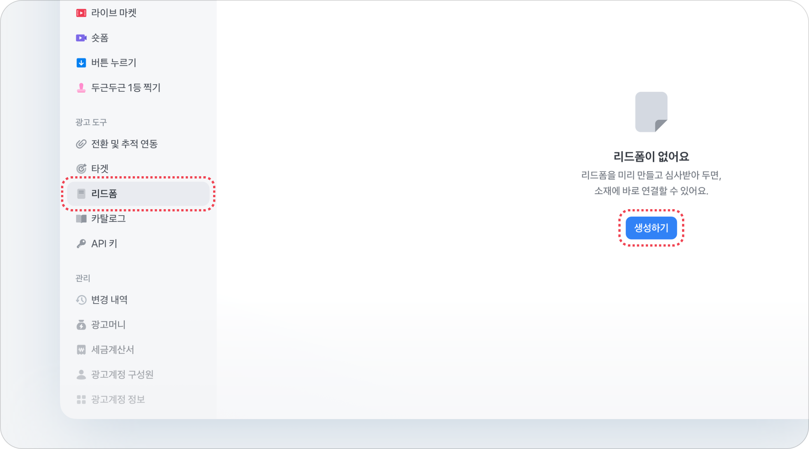
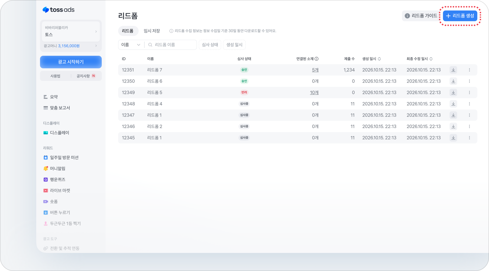
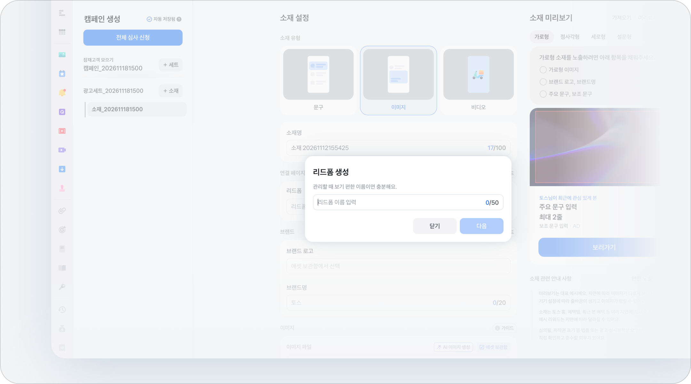
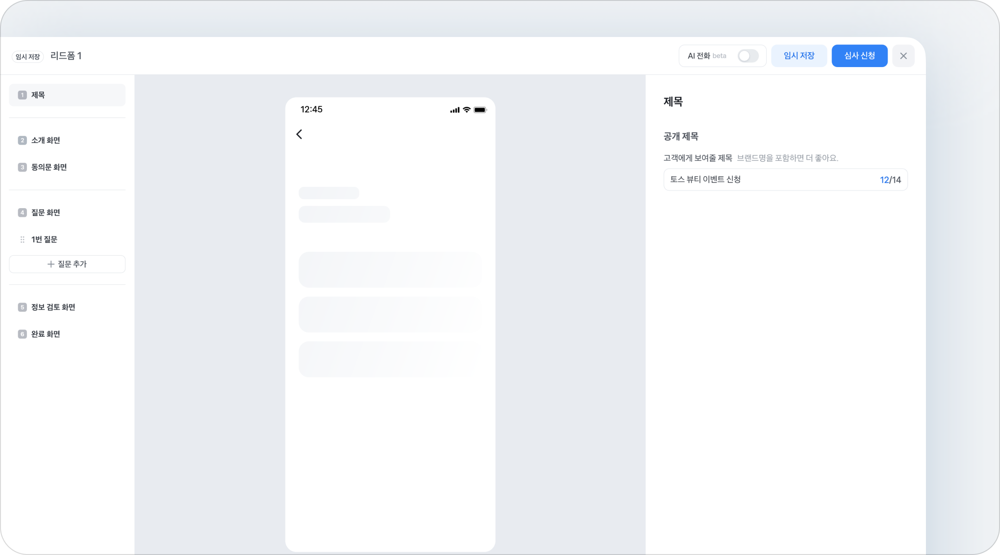
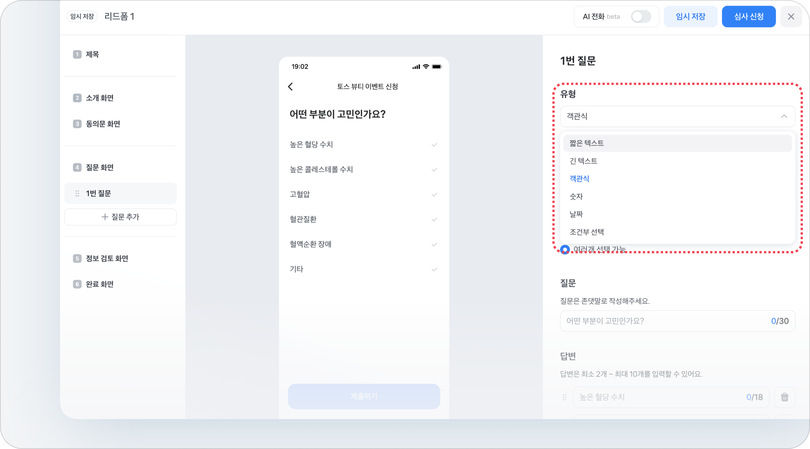
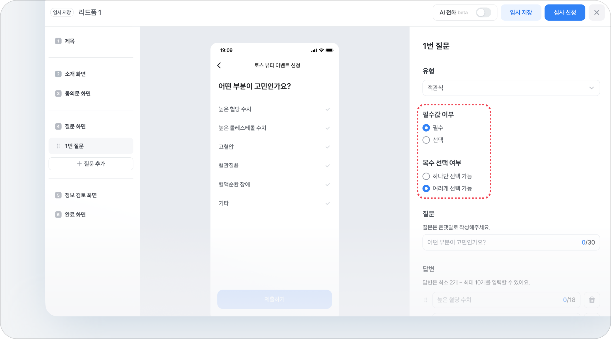
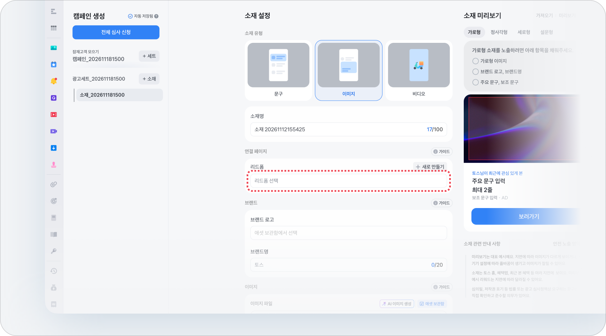
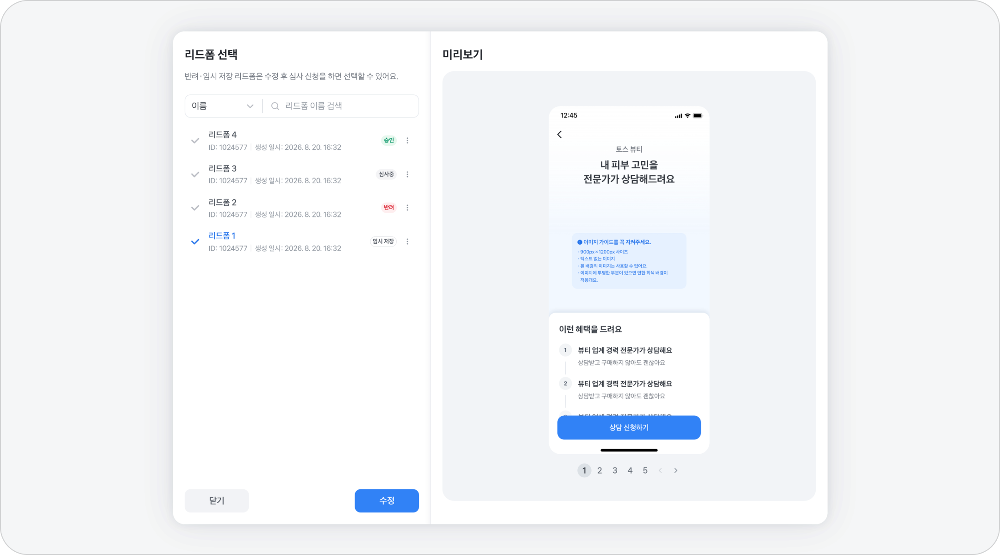
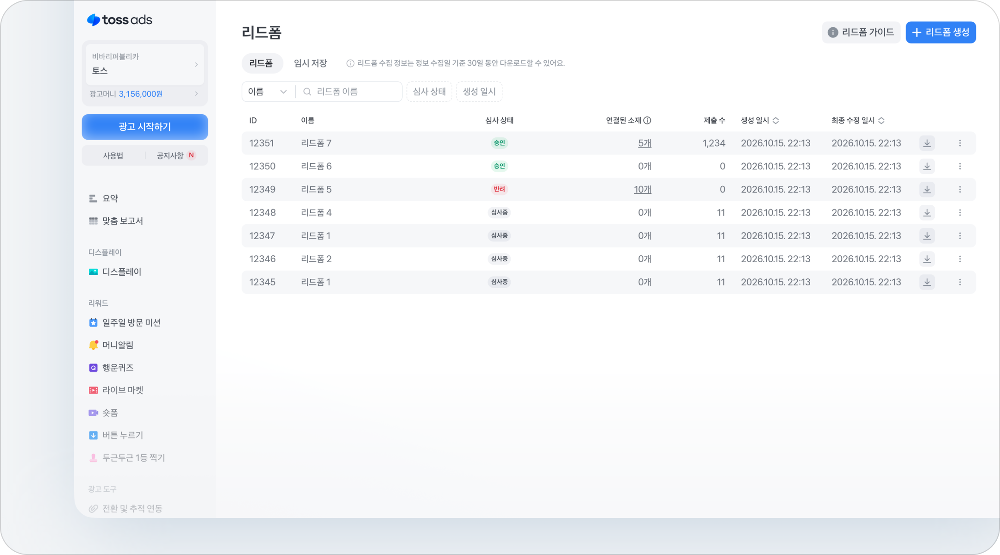

# 잠재고객 수집 방식 - 토스 리드폼

토스 리드폼은 토스 안에서 바로 고객 정보를 받는 잠재고객 수집 방식이에요. 리드폼은 한 번 만들어 심사받으면 여러 소재에 연결해 쓸 수 있어요.

이 가이드를 보면 리드폼을 만들고 소재에 연결하는 방법을 처음부터 끝까지 확인할 수 있어요.

유저가 리드폼에 들어오려고 누르는 **광고 배너**는 [배너 소재 가이드](/broken/pages/ybN3f0RF02UDaKDfjIQE)에서 확인해 주세요.


**캠페인에서 잠재고객 수집 방식을 외부 URL로 선택했나요?**

[**외부 URL** 가이드](url.md)를 확인해 주세요.


## 리드폼 알아보기 

리드폼을 미리 만들고 심사받아 두면 소재에 바로 연결할 수 있어요.

* 리드폼은 **광고 도구 > 리드폼**과 소재 설정 화면 어디서든 만들 수 있어요.
* 하나의 리드폼을 여러 소재에 연결할 수 있어요.
* 소재에 연결할 수 있는 리드폼은 **심사 중**이거나 **승인**된 리드폼이에요.

**리드폼 상태**

| 상태        | 설명                             | 수정 | 소재에 연결             |
| --------- | ------------------------------ | -- | ------------------ |
| **임시 저장** | 저장만 하고 아직 심사를 신청하지 않았어요.       | 가능 | 수정해서 심사 신청하면 연결돼요. |
| **심사 중**  | 심사를 기다리고 있어요.                  | 불가 | 가능                 |
| **승인**    | 심사를 통과했어요.                     | 불가 | 가능                 |
| **반려**    | 심사를 통과하지 못했어요. 반려 사유를 확인해 주세요. | 가능 | 수정해서 심사 신청하면 연결돼요. |


심사 중이거나 승인된 리드폼은 수정할 수 없어요. 내용을 바꾸려면 복제해서 새로 만들어 주세요.


## 리드폼 만들기 

캠페인 설정의 **잠재고객 수집 방식**에서 **토스 리드폼**을 선택했다면, 소재 설정에서 아래 순서대로 리드폼을 만들어 주세요.

소재 없이 리드폼만 미리 만들어 두려면 **광고 도구 > 리드폼**에서 **리드폼 생성**을 눌러 주세요. 이후 입력 순서는 아래와 같아요.

<figure> 리드폼에서 생성하기를 누르는 화면"><figcaption></figcaption></figure>

<figure> 리드폼 목록에서 리드폼 생성을 누르는 화면"><figcaption></figcaption></figure>



### 새로 만들기 

소재 설정의 **연결 페이지 > 리드폼**에서 **새로 만들기**를 눌러 주세요.

이미 만든 리드폼을 연결하려면 **리드폼 선택**을 눌러 주세요. 자세한 방법은 [리드폼 연결하기](toss-form.md#connect-leadform)를 확인해 주세요.

<figure> 리드폼에서 새로 만들기를 누르는 화면"><figcaption></figcaption></figure>



### 리드폼 이름 입력하기 

**리드폼 생성** 창에 리드폼 이름을 입력하고 **다음**을 눌러 주세요.

* 공백 포함 최대 50자까지 입력할 수 있어요.
* 저장한 뒤에도 편집 화면 왼쪽 위 **이름 수정**이나 **광고 도구 > 리드폼**에서 바꿀 수 있어요.

<figure><figcaption></figcaption></figure>



### 제목 작성하기 

유저에게 보여줄 **공개 제목**을 입력해 주세요.

* 공백 포함 최대 14자까지 입력할 수 있어요.
* 제목에 입력한 내용은 설문 조사 종료 직전까지 상단에 계속 보여요.
* 광고 효율을 위해 브랜드명을 포함해서 입력하는 것을 권장해요.
* 유저가 설문을 완료한 것으로 오해할 수 있는 문장으로 구성하면 정보 수집이 원활하지 않을 수 있어요.
  * 예시) 연락처만 입력하면 완료!/이벤트 선착순 종료 등

<figure><figcaption></figcaption></figure>



### 소개 화면 작성하기 

소개 화면은 유저가 광고를 눌렀을 때 가장 먼저 보는 화면이에요. 어떤 혜택을 받을 수 있는지 보여주고, 유저가 버튼을 눌러 정보 입력 단계로 넘어가게 해요.

<mark style="color:red;">**반드시 아래 탭 내용을 확인해 주세요.**</mark>

<figure><figcaption></figcaption></figure>




**반드시 지켜 주세요**

* 문장은 명사형 또는 \~해요체로 써야 해요.
* 초성은 쓸 수 없어요.


화면 맨 위, 배경 이미지 위에 얹혀서 보이는 문구예요.

전달하려는 정보는 이미지에 넣지 말고 **설명 문구** 입력란을 활용해 주세요.

브랜드명과 제목이 얹히는 이미지 위쪽 영역은 자동으로 블러·그라디언트 처리돼요.

| 입력란      | 규정                                             |
| -------- | ---------------------------------------------- |
| **브랜드명** | 공백 포함 최대 20자.                                  |
| **제목**   | 
공백 포함 최대 24자.

줄바꿈해서 두 줄로 입력해 주세요.
 |




**반드시 지켜 주세요**

* 안전 노출 영역(가운데 640px)에 문구를 넣지 마세요.
* 배경이 없는 이미지(누끼 딴 이미지)나 흰 배경 이미지는 쓸 수 없어요.


소개 화면의 배경으로 보이는 이미지예요. 위쪽은 상단 문구가 얹혀서 흐려지고, 아래쪽은 혜택 카드에 가려져요.

**입력 규정**

* 크기: 900px x 1200px
* 형식: JPG, JPEG, PNG (파일당 10MB 이하)
* 텍스트가 없는 이미지를 사용해 주세요. (전달하려는 정보는 **설명 문구** 입력란을 활용해 주세요.)

**영역별 노출 방식**

<table><thead><tr><th width="128">영역</th><th width="107.5">위치</th><th>이렇게 보여요</th><th>문구를 넣으면</th></tr></thead><tbody><tr><td>자동 블러·그라디언트 영역</td><td>위쪽 500px</td><td>
브랜드명과 제목이 겹치고, 자동으로 흐려져요.

주요 피사체를 두지 말고 대비가 약한 배경으로 채워 주세요.
</td><td>반려하지 않아요. 다만 잘 안 보여요.</td></tr><tr><td>안전 노출 영역</td><td>가운데 640px</td><td>이미지가 그대로 보여요.  주요 피사체와 그래픽은 여기에 두세요.</td><td><strong>반려돼요.</strong> 혜택 문구는 설명 문구에 써 주세요.</td></tr><tr><td>가려지는 영역</td><td>아래쪽 60px</td><td>혜택 카드에 가려질 수 있어요.  중요한 요소를 두지 말아 주세요.</td><td>반려하지 않아요. 다만 가려져요.</td></tr></tbody></table>

<figure><figcaption></figcaption></figure>




**반드시 지켜 주세요**

* 의료·미용·금융처럼 혜택 광고가 법으로 제한된 업종은 '일반'을 골라 주세요.


소개 화면의 메인 타이틀을 정하는 항목이에요. 두 가지 유형 중에서 고르면 메인 타이틀이 아래와 같이 고정돼요.

| 유형     | 메인 타이틀 (고정)   | 이럴 때 선택해요                                 |
| ------ | ------------- | ----------------------------------------- |
| **혜택** | 이런 혜택을 드려요    | 이벤트 참여로 유저가 받는 혜택이 있을 때                   |
| **일반** | 자세히 상담 받아 보세요 | 혜택과 관련 없는 내용이거나, 혜택 제공 문구가 법적으로 제한된 업종일 때 |

<figure><figcaption></figcaption></figure>



<figure><figcaption></figcaption></figure>


**반드시 지켜 주세요**

* 심의필이 필요한 업종이라면 안내 문구를 꼭 입력해 주세요.


설명 문구 아래에 들어가요.

**입력 규정**

1. **광고 고지 문구**

* 심의필이 필요하지 않은 업종은 **문구 없음**을 선택해 주세요.
* 최대 **110자**까지 입력할 수 있어요.
* 예시) 준법감시인확인필 제26-B09-123호(2026-09-10 \~ 2027-09-11)

2. **광고 상세 설명**

* 심의필이 필요하지 않은 업종은 **문구 없음**을 선택해 주세요.
* 광고 고지 문구 외에 추가로 상세 설명이 필요한 업종은 이 기능을 사용할 수 있어요.
* 최대 **2000자**까지 입력할 수 있어요. **심의필 번호는 위의 ‘광고 고지 문구’**&#xB780;에 따로 입력해 주시고, 그 외의 상세 설명 문구만 여기에 입력해 주세요.


- 법적으로 필수 기재해야 하는 정보가 아닌 내용을 입력하면 심사 승인이 어려워요.
  * 상품의 특성·효능, 할인·혜택 등 상품을 소개하거나 홍보하는 문구
  * 광고 상품과 관련 없는 내용
- 입력하신 문구가 법적 필수 기재 사항으로 확인되지 않는 경우, 해당 문구의 기재 근거(관련 법령, 심의 기관 기준 등)와 기재 사유를 확인할 수 있는 자료를 요청드릴 수 있어요.





**반드시 지켜 주세요**

* 리스트에 특수문자나 이모지를 넣지 마세요.
* 문장은 명사형 또는 \~해요체로 써야 해요.
* 초성은 쓸 수 없어요.


**입력 규정**

* 리스트는 최소 2개, 최대 6개까지 넣을 수 있어요. **리스트 추가하기**로 추가하고, 필요 없는 리스트는 빼 주세요.
* 리스트 형태는 1줄과 2줄 중에서 골라요.

| 형태     | 입력란     | 규정                                 |
| ------ | ------- | ---------------------------------- |
| **1줄** | 제목      | 혜택 내용, 공백 포함 18자.                  |
| **2줄** | 제목 + 설명 | 혜택 내용 공백 포함 18자 + 부가 설명 공백 포함 20자. |

<figure><figcaption></figcaption></figure>




이 항목은 반려 기준이 없어요. 아래 선택지 중에서 고르면 돼요.


소개 화면 맨 아래 버튼에 들어가는 문구예요. 유저가 이 버튼을 누르면 정보 입력 단계로 넘어가요.

유저가 다음 화면에서 하게 될 행동과 맞는 문구를 아래 선택지 중에서 골라 주세요.

* 상담 신청하기
* 상담 시간 고르기
* 연락처 남기기
* 이벤트 참여하기
* 체험 신청하기
* 견적 받아보기
* 구경하기
* 신청하기
* 가입하기


토스 리드폼은 유저가 이 버튼을 누를 때 과금돼요.






### 동의문 화면 작성하기 

수집한 정보를 누가, 얼마 동안 쓰는지 유저에게 알리고 동의를 받는 화면이에요.



광고 집행사에는 수집한 정보를 실제로 활용하는 사업자명을 입력해 주세요.

* 국내: 사업자 등록증에 기재된 사업자명 그대로 작성
  * <mark style="color:$info;">예시) A사가 B사의 광고를 대행하는 경우, B사를 입력</mark>
* 국외: 수집한 정보를 활용하는 회사가 해외에 있으면 선택 / 사업자명과 소재 국가 작성
  * 광고 집행사가 해외 기업이면, 토스가 유저에게 이 항목에 대한 동의를 추가로 받아요.

<figure><figcaption></figcaption></figure>



이용 및 보유 기간은 제공되는 옵션 중에서 선택해 주세요.

12개월 이상으로는 설정할 수 없어요.

<figure><figcaption></figcaption></figure>

<mark style="color:orange;">**리드 수집 후 이용 기간**</mark>

* <mark style="color:orange;">토스의 개인정보 이용 및 보유 기간 정책에 따라 수집한 리드는 수집 후</mark> <mark style="color:orange;">**30일 동안 보관돼요.**</mark>
* <mark style="color:orange;">30일이 지난 리드는 다운로드할 수 없어요.</mark>



직접 작성한 동의문이 포함되면 토스 개인정보보호팀의 별도 심사가 진행돼서, 리드폼 심사가 약 1일 더 걸릴 수 있어요. 이 리드폼을 연결한 소재는 리드폼이 승인된 뒤에 심사가 시작돼요.

설정 항목

* 동의문 유형: 필수 항목/선택 항목
* 동의문 내용: 동의문 제목과 내용을 직접 입력

직접 만든 동의문은 최대 10개까지 추가할 수 있어요.





### 질문·답변 작성하기 

유저가 질문에 답하며 정보를 입력하는 화면이에요. 질문과 답변 선택지를 설정해요.


**반드시 지켜 주세요**

* 질문은 명사형 또는 \~해요체로 써야 하고, 초성은 쓸 수 없어요.
* 질문은 배너 소재, 소개 화면 내용과 관련 있어야 해요. 소재와 관련 없는 질문은 쓸 수 없어요.
  * 예시) 패션 업종에서 건강 정보 및 가족관계 수집
* 개인 민감정보를 수집하거나 불쾌감, 혐오감, 수치심을 느낄 수 있는 질문과 답변은 쓸 수 없어요.
  * 예시) 성 관련 내용, 인종, 정치 성향, 종교, 유전 정보, 범죄 정보, 신용 점수 등
* 개인정보 수집 동의 여부와 상관없이 고유 식별 번호와 금융 정보는 수집하거나 쓸 수 없어요.
  * 예시) 주민등록번호, 카드번호, 여권 번호, 운전면허 번호 등




**유형별 선택 가이드**

* 짧은 텍스트: 간단한 답변 수집이 필요한 경우
* 긴 텍스트: 주관식 답변 수집이 필요한 경우
* 객관식: 선택지는 최소 2개, 최대 10개까지 설정 가능
* 숫자: 질문을 확인한 유저는 숫자로만 답변 가능
* 날짜: 날짜를 기준으로 답변 수집이 필요한 경우
* 조건부 선택: 첫 번째 질문의 답변에 따라 두 번째 질문 내용이 달라지는 경우

<figure><figcaption></figcaption></figure>



질문 유형에 따라 필수 값 여부와 복수 선택(**여러 개 선택 가능**) 여부를 선택할 수 있어요.

꼭 받아야 하는 답변이라면 필수로 설정해 주세요.

<figure><figcaption></figcaption></figure>




**1번 질문은 설문형 배너의 제목으로 보여요.**

소재를 설문형으로 설정하면 1번 질문이 배너 제목이 되고, 1번 질문의 답변이 배너의 선택지가 돼요. 유저는 배너 이미지 없이 이 질문만 보고 참여할지 정해요.

1번 질문에는 서비스의 장점이나 유저에게 알리고 싶은 내용이 드러나게 써 주세요.


* 공백 포함 최대 30자까지 입력할 수 있어요.
* 최소 1개, 최대 8개까지 만들 수 있어요.
* 질문을 더 넣으려면 왼쪽 목록에서 **+ 질문 추가하기**를 눌러 주세요.



* 공백 포함 최대 18자까지 입력할 수 있어요.
* 최소 2개, 최대 10개까지 넣을 수 있어요.
* 답변을 더 넣으려면 답변 목록 아래 **+ 답변 추가하기**를 눌러 주세요.
* 화살표(**∧ ∨**)로 답변 순서를 바꾸고, 휴지통으로 지울 수 있어요.
* 여러 개를 고를 수 있게 하려면 여러 개 선택 가능을 켜 주세요.





### 정보 검토 화면 설정하기 

유저가 제출 전에 자신의 정보를 확인하고 수정하는 화면이에요. 여기서 선택한 항목은 동의문 화면에도 자동으로 반영돼요.

* 연락처 (필수): 휴대전화 번호, 이메일
* 사용자 정보 (선택): 이름, 성별, 생년월일



### 완료 화면 설정하기 

유저가 정보를 제출한 뒤 보는 마지막 화면이에요. 완료 후 이동할 곳과 안내 문구를 설정해요.



* 유저가 정보 입력을 마친 뒤 이동할 곳을 선택해 주세요.
  * 종료하기: 토스 혜택 홈 화면으로 이동
  * 이벤트 페이지로 이동: 설정한 랜딩 URL 페이지로 이동



* 리드폼 심사에 활용할 이벤트 페이지 랜딩 URL을 입력해 주세요.
* 랜딩 URL이 없으면 리드폼과 배너 소재를 심사할 수 없어서 승인되지 않아요.

**유의사항**

* [**유저가 접속할 때 이상이 없어야 해요**](https://toss-ads.gitbook.io/guide/review/creativeguide#landing-access)**.**
  * 앱으로 랜딩된다면, 앱 미설치 유저는 앱 스토어/구글 플레이스토어로 랜딩될 수 있어야 해요.
  * 랜딩 과정에서 접속하는 데 5초 이상 걸리면 브릿지 페이지를 만들어 주세요.
* [**랜딩/이벤트 페이지의 내용과 소재 내용이 일치해야 해요**](https://toss-ads.gitbook.io/guide/review/creativeguide#landing-content)**.**
  * 랜딩/이벤트 페이지에서 확인할 수 없는 혜택이나 정보는 광고가 승인되지 않아요.
  * 가입 또는 응모와 같이 선행 조건이 따르는 혜택은 광고 문구 내에 반드시 명시해야만 사용할 수 있어요.
* [**URL 주소는 반드시 영문으로 입력해 주세요**](https://app.gitbook.com/s/LDHAecJlxONGwColZozo/review/creativeguide#landing-and-deeplink)**.**
  * 주소에 한글이 있으면 오류가 발생할 수 있어요.
  * 링크에 { } ^ # 기호가 있으면 반려될 수 있어요.
    * ^ 대신 \_(언더바)를 사용해 주세요.
  * http://는 쓸 수 없어요. https://를 사용해 주세요.
* 앱스플라이어로 생성한 원링크를 제출할 경우, 파라미터가 단축되지 않은 원본 롱링크를 제출해 주세요.
* 숏링크/단축 URL 형태는 사용할 수 없어요. (비틀리 포함)
* 이 외의 사유로 CTA 링크에 이슈가 있다고 판단되는 경우, 링크 수정을 요청할 수 있어요.
* 그 외 공통으로 적용되는 정책은 [소재별 심사 정책](https://app.gitbook.com/s/LDHAecJlxONGwColZozo/review/creativeguide#landing-and-deeplink)을 참고해 주세요.



* 전화 응답률을 높이기 위해 전화할 시간을 안내할 수 있어요.
* 보조 문구를 쓰지 않으려면 **보조문구 사용 안함**을 선택해 주세요.

<figure><figcaption></figcaption></figure>



* 리드폼 유형은 5가지 옵션 중에서 선택할 수 있어요. 선택한 유형에 따라 완료 화면의 문구가 다르게 보여요.
* 구성한 리드폼에 맞는 유형이 없다면 **해당 없음**을 선택해 주세요.

<figure><figcaption></figcaption></figure>



[잠재고객 모으기 웹훅 연동 가이드](../../tracking/webhook.md)를 참고해 주세요.





### 임시 저장·심사 신청하기 

* 다 채우지 못했다면 오른쪽 위 **임시 저장**을 눌러 주세요. 임시 저장한 리드폼은 소재에 연결되지 않고, 나중에 이어서 작성할 수 있어요. 임시 저장한 리드폼은 마지막으로 수정한 때부터 14일 동안 보관된 뒤 삭제돼요.
* 왼쪽 목록에서 **미완료** 표시가 모두 사라졌는지 확인하고, 오른쪽 위 **심사 신청**을 눌러 주세요. 모두 입력해야 심사 신청할 수 있어요.
* 심사를 신청할 때 **심사에 참고할 의견**과 **증빙 자료**를 함께 낼 수 있어요(선택). 증빙 자료는 JPG, JPEG, PNG, PDF 형식으로 3MB 이하만 올릴 수 있어요.
* 심사를 신청하면 리드폼이 **심사 중**이 되고, 소재에 연결할 수 있어요. 심사가 끝날 때까지 리드폼을 수정할 수 없어요.
* 유저에게는 아래와 같은 흐름으로 보여요.

<figure><figcaption></figcaption></figure>



## 리드폼 연결하기 

1. 소재 설정의 **연결 페이지 > 리드폼**에서 **리드폼 선택**을 눌러 주세요.
2. **리드폼 선택** 창에서 연결할 리드폼을 골라 주세요.
3. 리드폼 상태에 따라 아래처럼 연결돼요.

| 리드폼 상태           | 연결 방법                                         |
| ---------------- | --------------------------------------------- |
| **심사 중**, **승인** | **선택**을 누르면 바로 연결돼요.                          |
| **반려**           | **수정**을 눌러 반려 사유를 확인하고 고친 뒤 **심사 신청**하면 연결돼요. |
| **임시 저장**        | **수정**을 눌러 남은 항목을 채우고 **심사 신청**하면 연결돼요.       |

<figure> 리드폼에서 리드폼 선택을 누르는 화면"><figcaption></figcaption></figure>

<figure><figcaption></figcaption></figure>


**리드폼을 수정하면 연결된 모든 소재에 함께 반영돼요.** 이 리드폼을 쓰는 모든 소재의 리드폼이 같이 바뀌니 확인한 뒤 진행해 주세요.


* **리드폼 선택** 창의 더보기 메뉴에서 이름 수정, 복제, 삭제를 할 수 있어요.
* 임시 저장·반려 소재는 연결된 리드폼을 다른 리드폼으로 바꿀 수 있어요. 심사 중이거나 승인된 소재는 리드폼을 바꿀 수 없어요.
* 임시 저장 소재를 지워도 연결된 리드폼은 지워지지 않아요.

## 리드폼 심사와 소재 심사 

리드폼과 소재는 따로 심사받아요. 소재 심사는 연결된 리드폼이 승인된 뒤에 시작돼요.

**소재 심사를 신청할 수 있는 경우**

| 연결된 리드폼  | 소재 심사 신청                                          |
| -------- | ------------------------------------------------- |
| **승인**   | 신청할 수 있어요. 소재 심사가 바로 시작돼요.                        |
| **심사 중** | 신청할 수 있어요. 리드폼이 승인되면 소재 심사가 이어서 시작돼요.             |
| **반려**   | 신청할 수 없어요. 리드폼을 수정해서 다시 심사 신청하거나 다른 리드폼으로 바꿔 주세요. |

**소재 심사 중에 리드폼이 반려되면**

* 소재는 반려되지 않고 심사가 멈춰요. **심사 반려** 뱃지를 확인하고, 리드폼을 수정해 다시 심사 신청해 주세요.
* 리드폼을 수정해 다시 심사 신청하면 리드폼이 승인된 뒤 소재 심사가 이어져요. 소재는 다시 제출하지 않아도 돼요.
* 심사 반려 상태에서는 연결된 리드폼을 다른 리드폼으로 바꿀 수 없어요.


리드폼 심사 결과(승인·반려)는 심사를 신청한 계정의 이메일로 알려드려요.


## 광고 도구에서 리드폼 관리하기 

왼쪽 메뉴 **광고 도구 > 리드폼**에서 광고계정의 리드폼을 한 번에 보고 관리할 수 있어요.

<figure> 리드폼 목록 화면"><figcaption></figcaption></figure>

* **리드폼** 탭에서는 심사 중·승인·반려 리드폼을, **임시 저장** 탭에서는 임시 저장한 리드폼을 확인할 수 있어요.
* 리드폼별로 ID, 이름, 심사 상태, 연결된 소재 수, 제출 수, 생성 일시, 최종 수정 일시를 볼 수 있어요.
* **연결된 소재** 수를 누르면 이 리드폼을 쓰는 소재 목록을 확인할 수 있어요. 심사 중이거나 승인·반려·종료된 소재만 보이고, 임시 저장한 소재는 보이지 않아요.
* 오른쪽 위 **리드폼 생성**을 누르면 소재 없이 리드폼만 만들 수 있어요.

**더보기 메뉴**

| 메뉴        | 이렇게 동작해요                                                  |
| --------- | --------------------------------------------------------- |
| **이름 수정** | 공백 포함 최대 50자까지 바꿀 수 있어요. 이름을 수정해도 심사 상태는 달라지지 않아요.        |
| **복제**    | 복제본 이름을 정하고 새 리드폼을 만들 수 있어요.                              |
| **삭제**    | 심사 중·승인·반려·종료 소재에 연결된 리드폼은 삭제할 수 없어요. 삭제한 리드폼은 되돌릴 수 없어요. |
