# 성과 보기

디스플레이 광고 성과 대시보드에서 캠페인·광고세트·소재를 운영하고 주요 지표를 확인하는 방법을 안내해요. 분석 기준과 지표를 직접 조합해 데이터를 비교하려면 [맞춤 보고서로 보는 광고 성과](../reports/report.md)를 확인해 주세요.

## 성과 조회 

### 기본 성과 조회 

대시보드에서 배너 광고 캠페인/세트/소재 단위로 광고 집행 기간 동안의 성과를 확인할 수 있어요.

* 조회 기간은 기본으로 ‘오늘’ 하루로 선택되어 있고, 변경할 수 있어요.
* **성과 데이터는 1시간 단위**로 업데이트돼요.

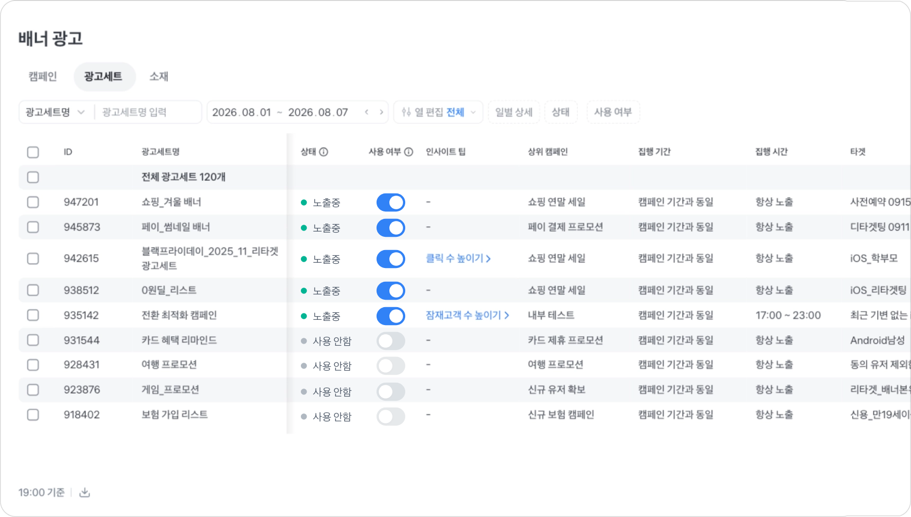

* **열 편집 > 내 설정**에서 내가 보고 싶은 열만 골라서 직접 설정하거나, 지표별・전환 목표별로 제공되는 추천 설정을 사용할 수 있어요.

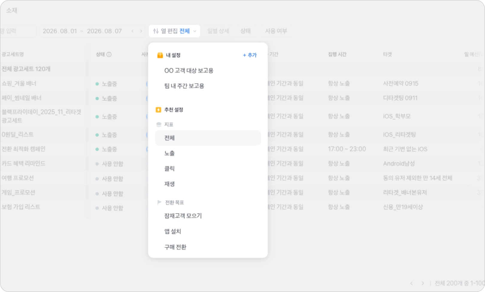

그 외 대시보드 기능이 궁금하다면 [대시보드 유용한 기능](performance.md#dashboard-features)을 확인해 주세요.

### 일별 성과 조회 

* **일별 상세** 버튼을 누르면 캠페인 광고 집행 기간의 성과를 일별로 확인할 수 있어요.
* 일별 성과는 최대 30일까지 조회할 수 있어요.

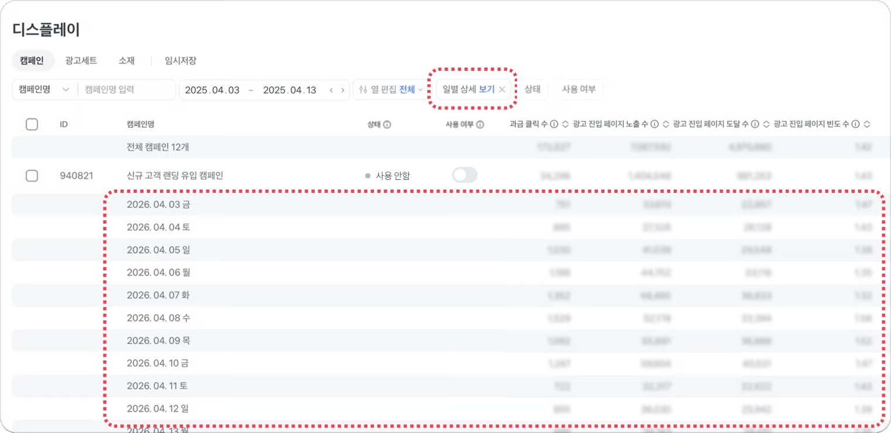

### 시간대별 성과 조회 

* 최근 30일의 시간대별로 성과 데이터를 볼 수 있어요.
* 선택한 캠페인 수나 데이터 양이 많으면 다운로드에 실패할 수 있어요. 이때는 선택 범위를 줄여 다시 시도해 주세요.

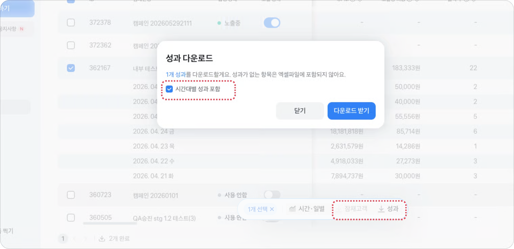

***

## 성과 다운로드 

성과 다운로드는 캠페인 집행이 시작되고 1시간 이후부터 가능해요.

### 개별 다운로드 

캠페인/세트/소재 각각의 탭에서 성과를 엑셀 파일로 다운로드할 수 있어요.

* 경로: 배너 성과 탭 → **\[다운로드]** 버튼 → **\[성과]** 버튼

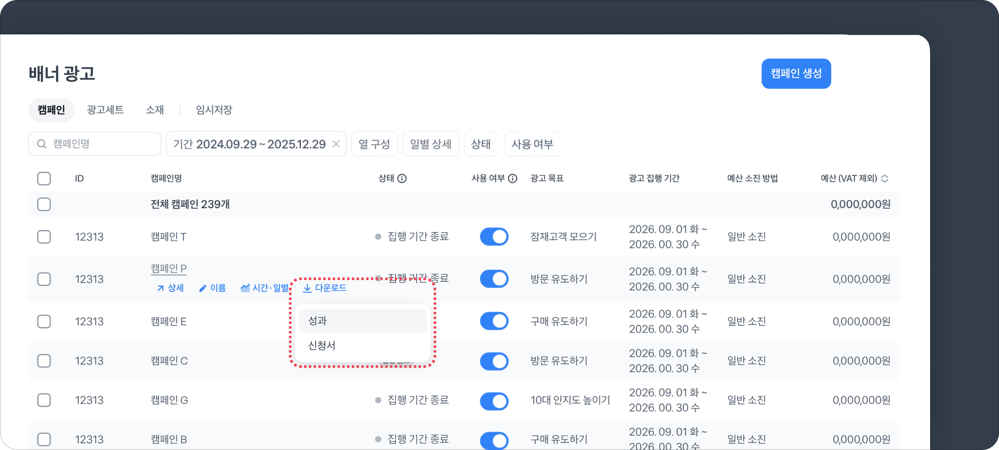

### 일괄 다운로드 

여러 개의 캠페인/세트/소재를 선택한 후 하단 **\[성과]** 버튼을 누르면 여러 성과를 한 번에 다운로드할 수 있어요.

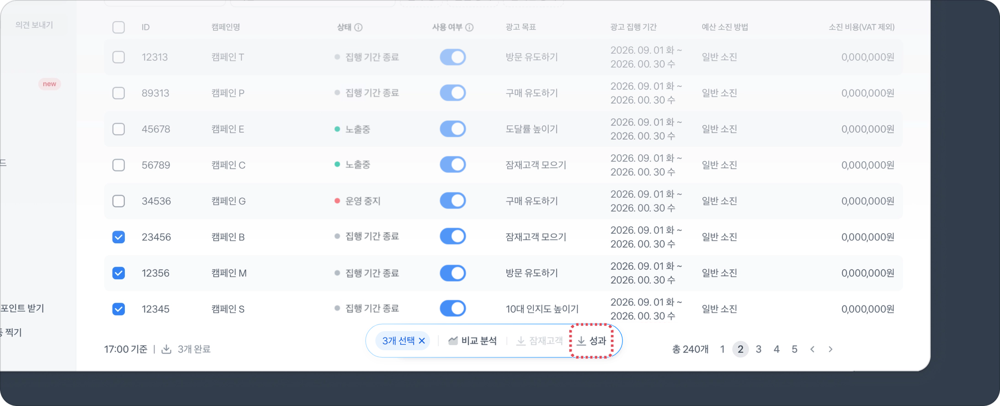


**성과 다운로드 내역 조회**

배너 성과 대시보드 하단의 성과 다운로드 팝업에서 최근 7일 동안 다운로드한 내역을 볼 수 있어요. 다운로드 내역은 7일 이후 자동으로 삭제되고 따로 저장되지 않아요.


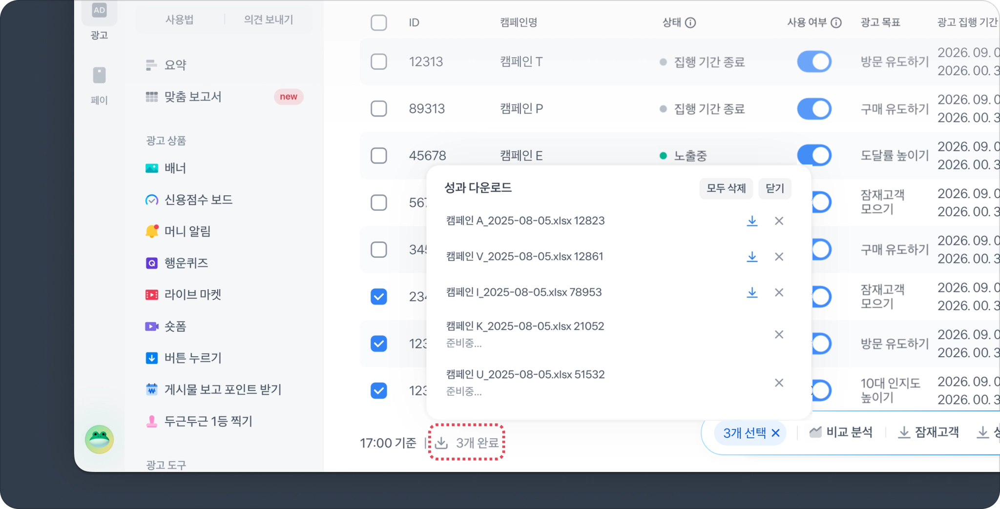

### 잠재고객 다운로드 

잠재고객 모으기로 수집된 리드는 캠페인 목록에서 바로 다운로드할 수 있어요.

* **잠재고객 수가 1건 이상 있어야 \[잠재고객]** 버튼이 활성화돼요.

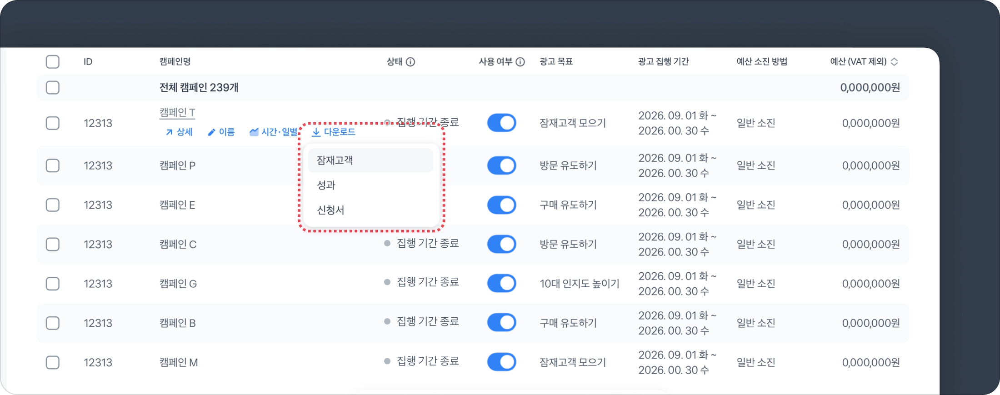

* 여러 캠페인을 선택하고 하단 **\[잠재고객]** 버튼을 누르면 원하는 캠페인의 잠재고객 데이터를 한 번에 다운로드할 수 있어요.

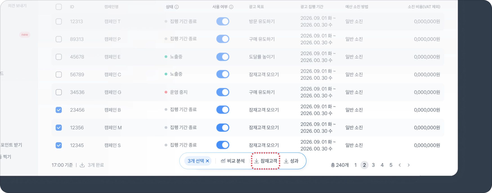

***

## 성과 시간·일별 비교 

시간별 또는 일별로 원하는 캠페인/세트/소재의 성과 추이를 그래프로 볼 수 있어요. 대시보드에서 제공하는 모든 성과 지표를 비교할 수 있어요.

* 소진 비용, 과금 클릭 수, CPC, CPM
* 광고 진입 페이지 노출 수, 광고 진입 페이지 도달 수, 광고 진입 페이지 도달당 비용, 광고 진입 페이지 빈도 수, 광고 진입 CTR, 광고 진입 클릭 수
* 랜딩 직전 페이지 노출 수, 랜딩 직전 페이지 도달 수, 랜딩 직전 페이지 도달당 비용, 랜딩 직전 페이지 빈도 수, 랜딩 직전 CTR, 랜딩 직전 클릭 수
* 잠재고객 모으기, 앱 설치, 회원가입, 장바구니 담기, 구매의 전환 수, 전환당 비용, 전환율 등 전환 성과
  * 예: 잠재고객 수, 잠재고객 제출당 비용, 잠재고객 제출률
* 비교 데이터는 **시간대별/일별 단위**로 구분해 볼 수 있어요.
  * 시간대별: 최대 7일 이내
  * 일별: 최대 92일 이내

### 두 개 지표끼리 비교 

하나의 캠페인을 선택한 후 **시간・일별** 버튼을 누르면 오른쪽에서 x축과 y축에 각각 원하는 성과 지표를 설정해 비교할 수 있어요.

* 광고세트와 소재 탭에서도 같은 방법으로 비교할 수 있어요.

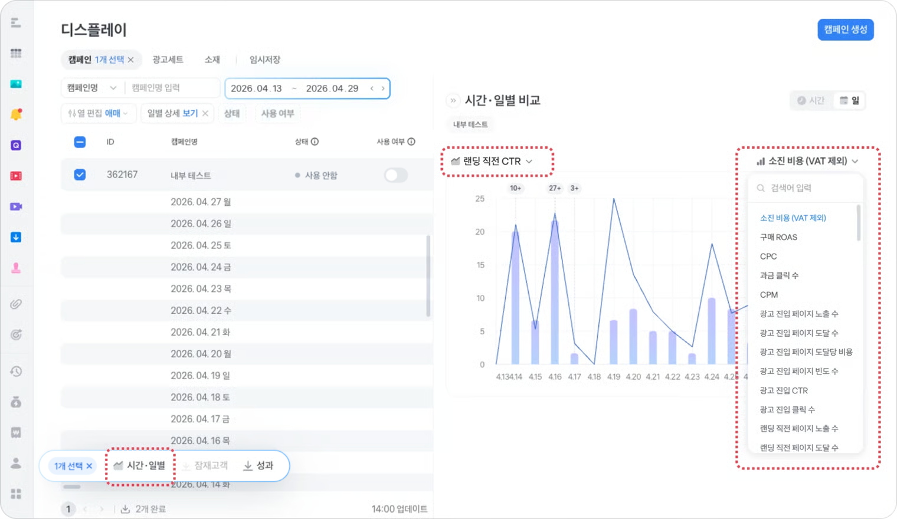

### 여러 캠페인끼리 비교 

여러 캠페인을 선택한 후 **시간・일별** 버튼을 누르면 한 성과 지표에 대해 여러 캠페인을 비교할 수 있어요.

* 성과 지표를 추가하면 여러 그래프가 추가돼요.
* 광고세트와 소재 탭에서도 같은 방법으로 비교할 수 있어요.

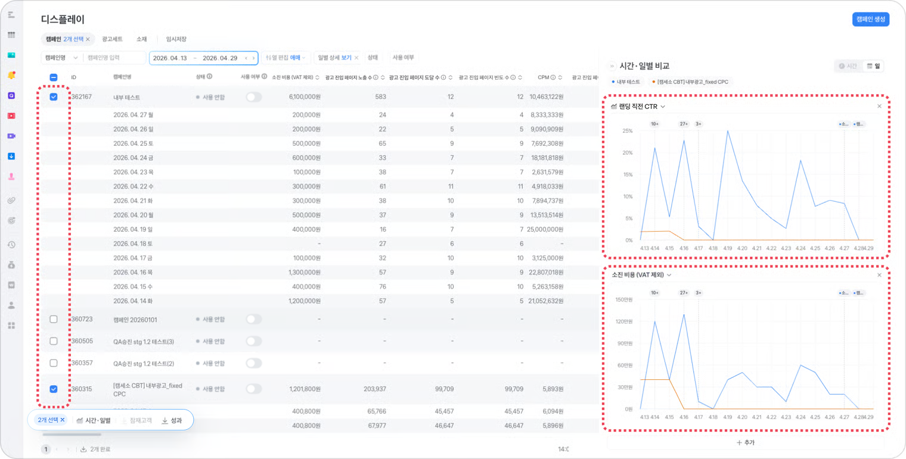

***

## 상태와 사용 여부 요약 

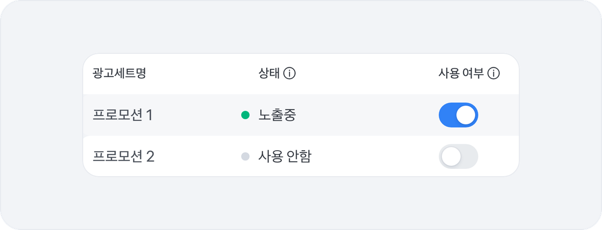

### 상태 

상태 열에서 광고가 노출 중인지, 노출되지 않는다면 이유가 무엇인지 한눈에 확인할 수 있어요. 여러 열을 조합하지 않고 상태 열만 보면 돼요.

* 집행·심사·노출 상태를 상태 하나로 확인해요.
* 여러 상태에 해당하면 우선순위가 가장 높은 상태 하나만 보여요.

### 사용 여부 

캠페인·광고세트·소재를 사용할지 직접 정하는 설정이에요. 사용 여부 열의 토글로 바꿀 수 있어요.

* **사용**: 운영 중지 이유나 심사에 문제가 없으면 노출돼요. 문제가 있으면 해결되는 대로 자동으로 노출돼요.
* **사용 안함**: 노출되지 않고, 상태 열에 '사용 안함'이 보여요.
  * 단, 소재가 심사 반려 상태면 사용 여부와 관계없이 상태 열에 '심사 반려'가 보여요.

***

## 캠페인·광고세트·소재 상태 

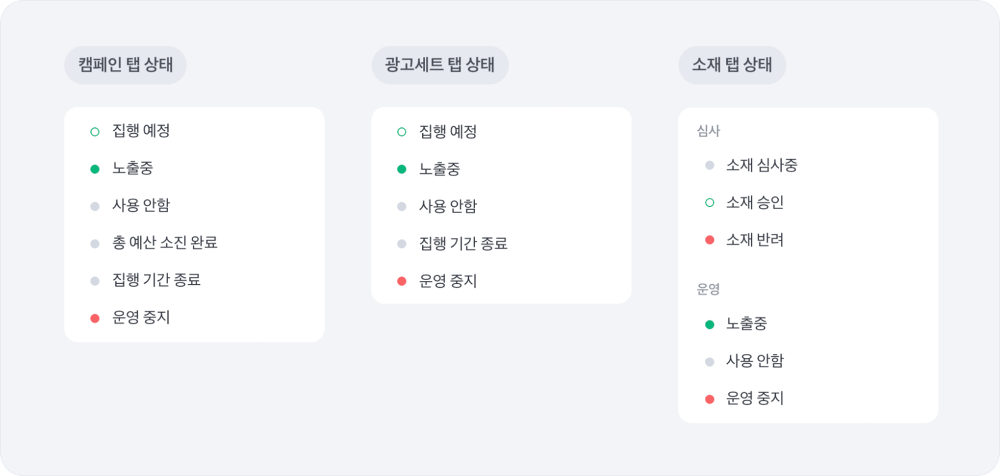

### 캠페인 상태 

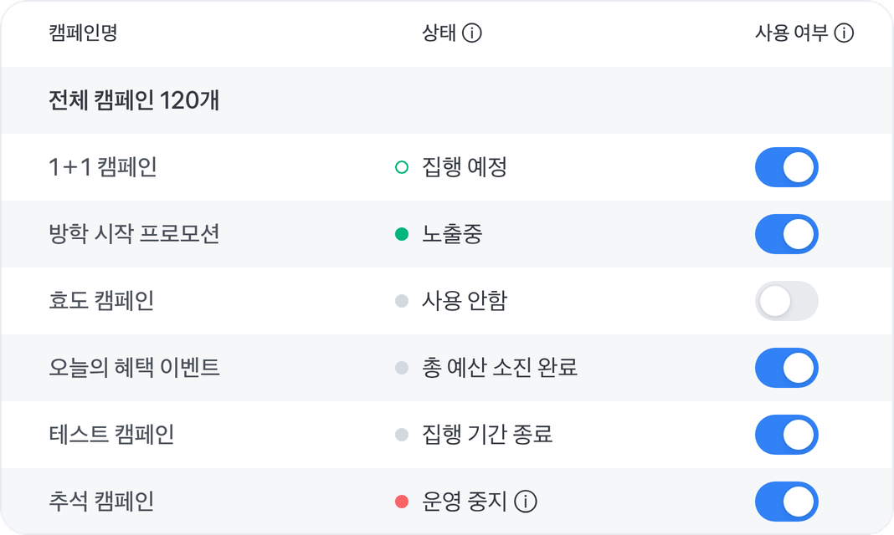

| 상태         | 의미                                                                                             |
| ---------- | ---------------------------------------------------------------------------------------------- |
| 집행 예정      | 
집행 기간이 시작되기 전이에요. 사용 여부가 ‘사용’이면 집행 기간이 시작될 때 자동으로 노출돼요.
                              |
| 노출중        | 광고가 노출 중이에요.                                                                                   |
| 사용 안함      | 사용 여부를 ‘사용 안함’으로 설정해 광고를 노출하지 않아요.                                                             |
| 총 예산 소진 완료 | 설정한 총 예산을 모두 써서 광고 노출이 끝났어요.                                                                   |
| 집행 기간 종료   | 집행 기간이 끝나 광고를 노출하지 않아요.                                                                        |
| 운영 중지      | 
광고 노출을 막는 문제가 있어요. ‘운영 중지’에 마우스를 올리면 이유를 볼 수 있어요. 사용 여부가 ‘사용’이면 문제가 해결될 때 자동으로 노출돼요.
 |

### 광고세트 상태 

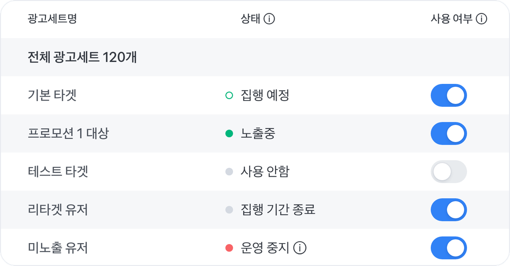

| 상태       | 의미                                                                                                           |
| -------- | ------------------------------------------------------------------------------------------------------------ |
| 집행 예정    | 
광고세트의 집행 기간이 시작되기 전이에요.  사용 여부가 ‘사용’이면 집행 기간이 시작될 때 자동으로 노출돼요.
                                     |
| 노출중      | 광고가 노출 중이에요.                                                                                                 |
| 사용 안함    | 사용 여부를 ‘사용 안함’으로 설정해 광고를 노출하지 않아요.                                                                           |
| 집행 기간 종료 | 광고세트의 집행 기간이 끝나 광고를 노출하지 않아요.                                                                                |
| 운영 중지    | 
광고세트나 상위 캠페인에 광고 노출을 막는 문제가 있어요. ‘운영 중지’에 마우스를 올리면 이유를 볼 수 있어요. 사용 여부가 ‘사용’이면 문제가 해결될 때 자동으로 노출돼요.
 |

### 소재 상태 

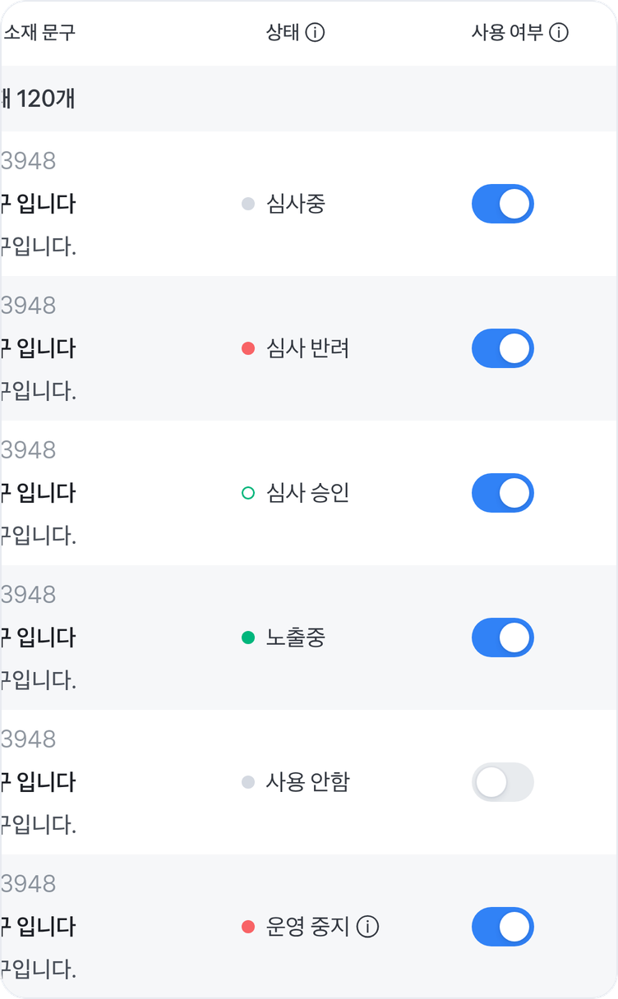

| 상태    | 의미                                                                                                              |
| ----- | --------------------------------------------------------------------------------------------------------------- |
| 심사중   | 소재를 심사하고 있어요.                                                                                                   |
| 심사 반려 | 소재가 심사를 통과하지 못했어요. 반려 사유를 확인하고 소재를 고쳐 다시 제출해 주세요.                                                               |
| 심사 승인 | 소재가 심사를 통과했어요. 캠페인·광고세트의 집행 기간이 시작되기를 기다리고 있어요.                                                                 |
| 노출중   | 광고가 노출 중이에요.                                                                                                    |
| 사용 안함 | 사용 여부를 ‘사용 안함’으로 설정해 광고를 노출하지 않아요.                                                                              |
| 운영 중지 | 
소재나 상위 캠페인·광고세트에 광고 노출을 막는 문제가 있어요. ‘운영 중지’에 마우스를 올리면 이유를 볼 수 있어요. 사용 여부가 ‘사용’이면 문제가 해결될 때 자동으로 노출돼요.
 |

## 운영 중지 상태와 이유 보기 

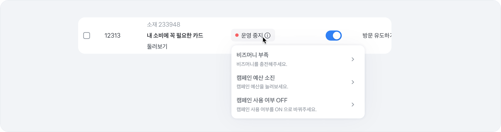

* ‘운영 중지’에 마우스를 올리면 광고가 노출되지 않는 이유를 모두 볼 수 있어요.
* 비즈머니 부족, 캠페인 예산 소진 완료처럼 직접 해결할 수 있는 문제는 해결 방법도 알려 드려요. 문제를 해결할 화면으로 바로 이동할 수 있어요.
* 사용 여부가 ‘사용’인 광고는 문제가 해결되고 집행 기간·예산·심사에 다른 문제가 없으면 자동으로 노출돼요.
* 사용 여부가 ‘사용 안함’인 광고는 문제가 해결돼도 자동으로 노출되지 않아요.

### 운영 중지 이유 

| 운영 중지 이유           | 내용                                                        | 원인 대상         |
| ------------------ | --------------------------------------------------------- | ------------- |
| 집행 제재              | 집행 제재되어 노출할 수 없어요.                                        | 캠페인           |
| 집행 기간 종료           | 집행 기간이 종료되어 노출할 수 없어요.                                    | 캠페인           |
| 연동된 카탈로그 없음        | 카탈로그가 삭제되어 광고를 노출할 수 없어요.                                 | 캠페인, 광고세트, 소재 |
| 연동된 상품세트 없음        | 상품세트가 삭제되어 광고를 노출할 수 없어요.                                 | 캠페인, 광고세트, 소재 |
| 연동된 앱 없음           | 광고 대상 앱이 삭제되어 광고를 노출할 수 없어요.                              | 캠페인, 광고세트, 소재 |
| 타겟 사용 불가           | 타겟 힌트에 해당하는 사용자가 0명이어서 노출할 수 없어요.                         | 광고세트          |
| 사용할 수 있는 쿠폰 없음     | 캠페인에 등록된 쿠폰의 잔액이 부족하거나 유효 기간이 만료됐어요.                      | 캠페인           |
| 비즈니스 그룹 후불 한도 초과   | 후불 한도가 초과되어 노출할 수 없어요.                                    | 비즈니스 그룹       |
| 비즈머니 부족            | 비즈머니를 충전해 주세요.                                            | 광고계정          |
| 캠페인 예산 소진 완료       | 캠페인 예산을 늘려 보세요.                                           | 캠페인           |
| 캠페인 사용 여부 ‘사용 안함’  | 캠페인 사용 여부를 ‘사용’으로 바꿔 주세요.                                 | 캠페인           |
| 쿠폰 사용 기간 아님        | 쿠폰 사용 시작일(YYYY. MM. DD.)이 되면 자동으로 노출돼요.                   | 캠페인           |
| 광고세트 사용 여부 ‘사용 안함’ | 광고세트 사용 여부를 ‘사용’으로 바꿔 주세요.                                | 광고세트          |
| 광고세트 집행 기간 종료      | 광고세트 집행 기간을 조정해 주세요.                                      | 광고세트          |
| 광고 가능 상품 없음        | 광고 가능한 상품이 없어요. 상품의 노출 불가 사유를 해결하거나 사용 여부를 ‘사용’으로 바꿔 주세요. | 광고세트          |
| 타겟 사용 불가           | 선택한 타겟에 해당하는 사용자가 0명이에요. 다른 타겟으로 변경해 주세요.                 | 광고세트          |

***

## 사용 여부 일괄 변경 

* 여러 광고세트나 소재를 선택하고 하단 **\[사용]** 또는 **\[사용 안함]** 버튼을 누르면 사용 여부를 한 번에 바꿀 수 있어요.
* 안내창에서 바꿀 내용을 확인하고 \[확인]을 누르면 선택한 항목에 적용돼요.

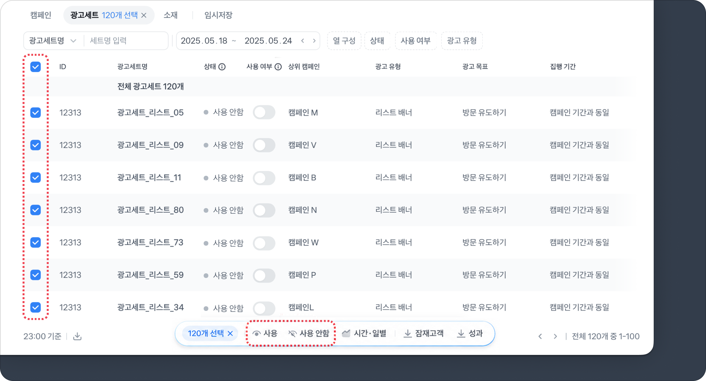

***

## 대시보드 유용한 기능 

### 상태·사용 여부 필터로 찾기 

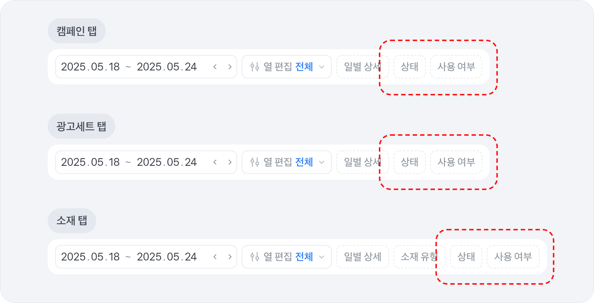

* 상태 필터에서 목록에 보이는 상태를 기준으로 캠페인·광고세트·소재를 찾을 수 있어요.
* 사용 여부 필터에서 ‘사용’ 또는 ‘사용 안함’으로 설정한 항목을 찾을 수 있어요.
* 두 필터를 함께 고르면 두 조건에 모두 맞는 항목만 보여요.

***

## 정보 수정 

* 상세 페이지로 이동하지 않아도 대시보드에서 아래 정보를 바로 수정할 수 있어요.
  * 캠페인
    * 캠페인명
    * 총 예산
    * 집행 기간
    * 소진 방법(일반/빠른)
  * 광고세트
    * 광고세트명
    * 입찰 금액
    * 집행 기간
    * 집행 시간(요일별 설정 제외)
  * 소재
    * 소재명

<figure><figcaption></figcaption></figure>

***

## 열 편집 

* 대시보드는 기본으로 모든 열을 보여줘요.
* **\[열 편집]** 버튼을 눌러 확인할 열의 순서와 구성을 바꿀 수 있어요.

.png>)

#### 내 설정 

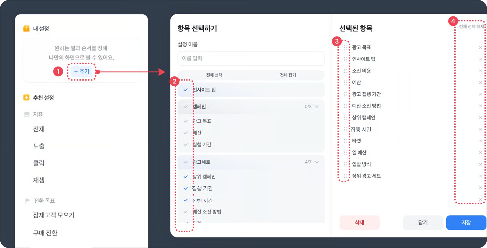

1. **\[+ 추가]** 버튼을 누르면 나만 볼 수 있는 열 구성을 추가할 수 있어요.
2. 왼쪽에서 구성할 열을 선택해요.
3. 오른쪽에서 손잡이를 위아래로 끌어 순서를 바꿔요.
4. 전체 선택을 해제해 처음부터 다시 선택하거나, **\[x]** 버튼을 눌러 개별 항목만 선택 해제할 수 있어요.

***

## 열 너비 조정 

* 대시보드 각 열의 너비를 자유롭게 조절할 수 있어요.
  * 변경한 너비는 따로 저장하지 않아도 새로 고침하거나 페이지를 나간 뒤에도 유지돼요.

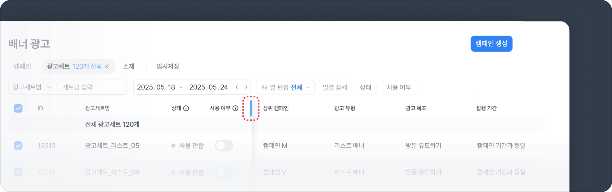

***

## 오름차순/내림차순 정렬 

* 각 열의 오른쪽 화살표 버튼을 눌러 정렬할 수 있어요.

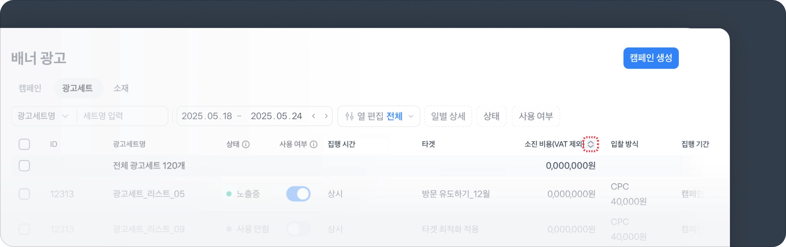

***

## 임시저장 캠페인 조회 

* 임시 저장한 캠페인은 배너 광고 대시보드 상단 **\[임시저장]** 탭에서 확인할 수 있어요.

<figure><figcaption></figcaption></figure>
