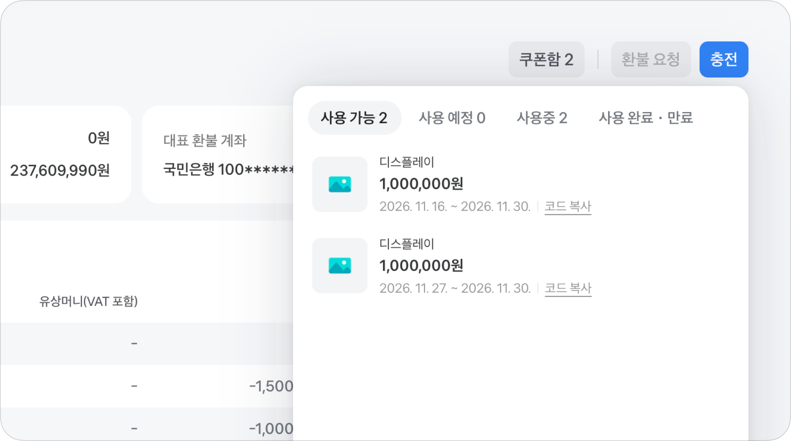

# 쿠폰

## 쿠폰이란? 

쿠폰은 토스애즈가 지급하는 광고비로, 쿠폰을 사용한 캠페인에서만 쓸 수 있어요. 비즈머니 화면에서는 **전용 무상머니 (쿠폰)**&#xC73C;로 표시돼요.

* 무상머니는 모든 캠페인에 자동으로 쓰이지만, 쿠폰은 쿠폰을 사용한 캠페인에만 쓰여요.
* 지금은 디스플레이 광고에서만 쓸 수 있어요.
* 쿠폰마다 유효 기간이 있어요. 유효 기간은 길어도 그 달 말일까지예요. 기간이 지나면 남은 금액은 사라져요.
* 쿠폰 금액은 광고가 집행된 만큼 매일 차감돼요.
* 쿠폰 금액은 비즈머니 총 잔액에 합쳐지지 않아요.

**유상머니 · 무상머니 · 쿠폰 한눈에 비교하기**

| 구분        | 유상머니          | 무상머니    | 쿠폰                      |
| --------- | ------------- | ------- | ----------------------- |
| 쓰이는 곳     | 모든 캠페인        | 모든 캠페인  | 쿠폰을 사용한 캠페인만            |
| 쓰이는 방법    | 자동으로 소진       | 자동으로 소진 | 토스애즈 담당자가 캠페인에 사용한 뒤 소진 |
| 확인하는 곳    | 비즈머니 잔액       | 비즈머니 잔액 | 쿠폰함                     |
| 광고비 내역의 열 | 유상머니 (VAT 포함) | 무상머니    | 전용 무상머니 (쿠폰)            |
| 세금계산서     | 포함            | 포함되지 않음 | 포함되지 않음                 |

***

## 쿠폰 받고 사용하기 

쿠폰은 토스애즈 담당자가 지급하고, 캠페인에 쿠폰을 사용해야 쓰이기 시작해요. 받기만 해서는 쓰이지 않으니 아래 순서대로 진행해 주세요.

1. **쿠폰 받기**: 토스애즈 담당자가 특정 캠페인에서 사용할 수 있도록 쿠폰을 지급해요. 받은 쿠폰은 **\[비즈머니] > \[쿠폰함]**&#xC758; '사용 가능' 탭에서 확인해요.
2. **쿠폰을 쓸 캠페인 정하기**: 새로 만들 캠페인이라면 광고세트와 소재를 꺼 둔 상태로 만들어 주세요. 이미 집행 중인 캠페인에도 쿠폰 사용이 가능해요.
3. **캠페인 ID 알리기**: 쿠폰을 사용할 캠페인의 ID를 토스애즈 담당자에게 알려 주세요.
4. **사용 확인하기**: 담당자가 캠페인에 쿠폰을 사용하면 쿠폰이 '사용 가능' 탭에서 '사용 예정' 또는 '사용중' 탭으로 옮겨져요. **\[쿠폰함]**&#xC5D0;서 쿠폰이 옮겨졌는지 확인해요. 따로 설정하지 않아도 쿠폰 사용 기간이 되면 그 캠페인의 광고비가 쿠폰에서 차감돼요.
5. **캠페인 켜기**: 2단계에서 꺼 둔 새 캠페인이라면, 쿠폰이 '사용 예정' 또는 '사용중' 탭으로 옮겨진 것을 확인한 뒤 켜 주세요. 이미 집행 중인 캠페인에 쿠폰을 사용하는 경우에는 그대로 두면 돼요.

아래 유의사항을 같이 확인해 주세요.

* 쿠폰을 사용하기 전에 집행된 광고비는 비즈머니에서 차감되고, 쿠폰으로 바꿀 수 없어요.
* 담당자가 없으면 [채널톡](http://toss-business.channel.io/)으로 문의해 주세요.

***

## 쿠폰함에서 확인하기 

1. **\[비즈머니]** 메뉴 오른쪽 위의 **\[쿠폰함]** 버튼을 누르면 화면 오른쪽에 쿠폰함이 펼쳐져요. 버튼의 숫자는 사용 가능한 쿠폰 수예요.
2. 탭을 눌러 상태별로 쿠폰을 확인해요.

쿠폰함이 펼쳐진 비즈머니 화면은 다음과 같아요.

| 탭          | 보이는 쿠폰                                 |
| ---------- | -------------------------------------- |
| 사용 가능      | 아직 캠페인에 사용하지 않은 쿠폰                     |
| 사용 예정      | 캠페인에 사용하기로 했고, 사용 시작일 전인 쿠폰            |
| 사용중        | 캠페인에서 쓰이고 있는 쿠폰. 남은 금액과 전체 금액이 함께 보여요. |
| 사용 완료 · 만료 | 다 썼거나 기간이 끝난 쿠폰. 최근 3개월만 보여요.          |

* 사용 예정·사용중 탭에서는 쿠폰이 캠페인별로 묶여 보여요. **\[보기]**&#xB97C; 누르면 그 캠페인으로 이동해요.
* '사용 완료 · 만료' 탭에 보이는 표시의 뜻은 아래 표를 참고해 주세요.

| 표시     | 뜻                                         |
| ------ | ----------------------------------------- |
| 사용 완료  | 쿠폰 금액을 모두 썼어요.                            |
| 기간 만료  | 금액이 남은 채 유효 기간이 끝났어요. 남은 금액이 함께 보여요.      |
| 캠페인 종료 | 캠페인이 종료되거나 집행 중단 상태여서 쿠폰의 남은 금액을 쓸 수 없어요. |

* **\[코드 복사]**&#xB97C; 누르면 쿠폰 코드를 복사할 수 있어요.
* 쿠폰을 한 번도 받은 적이 없으면 **\[쿠폰함]** 버튼이 보이지 않아요. 사용 가능한 쿠폰이 없으면 버튼에 숫자가 표시되지 않아요.
* 선불·후불 광고계정 모두 쿠폰함을 쓸 수 있어요.

***

## 유의사항 

* 쿠폰 유효 기간이 끝나면 캠페인이 집행 중이어도 쿠폰은 더 쓰이지 않아요. 남은 금액은 다음 달로 넘어가거나 다른 쿠폰에 합쳐지지 않아요.
* 캠페인에 한 번 사용한 쿠폰은 다른 캠페인으로 옮기거나 취소할 수 없어요. 쿠폰을 사용한 캠페인이 종료되거나 집행 중단되면 남은 쿠폰 금액은 돌려받을 수 없어요. 금액이 아직 차감되지 않은 쿠폰도 마찬가지예요.
* 쿠폰 때문에 광고가 멈추면 [성과 보기](../a-d/performance.md)의 운영 상태에 '사용할 수 있는 쿠폰 없음' 또는 '쿠폰 사용 기간 아님'으로 표시돼요.
* 세금계산서에는 유상머니로 쓴 금액만 포함돼요. 쿠폰과 무상머니로 쓴 금액은 포함되지 않아요.
