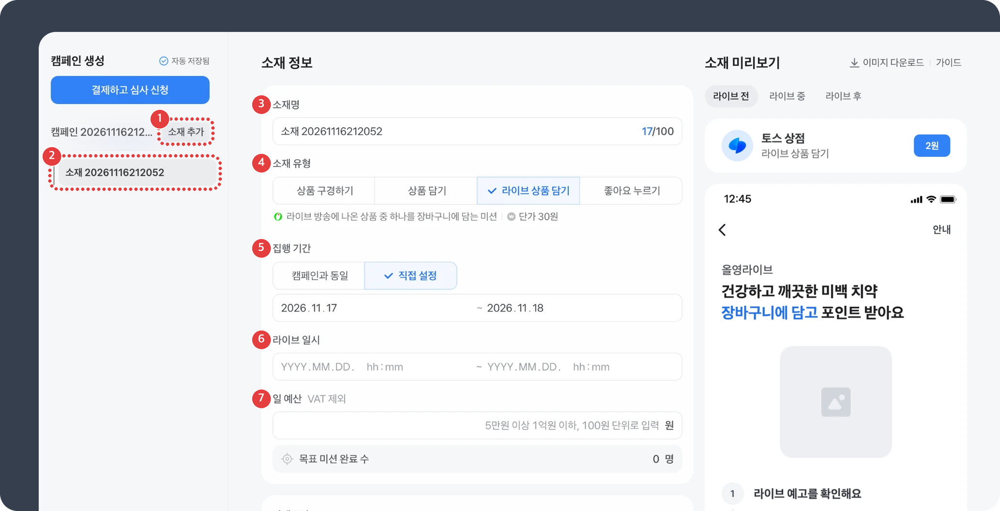
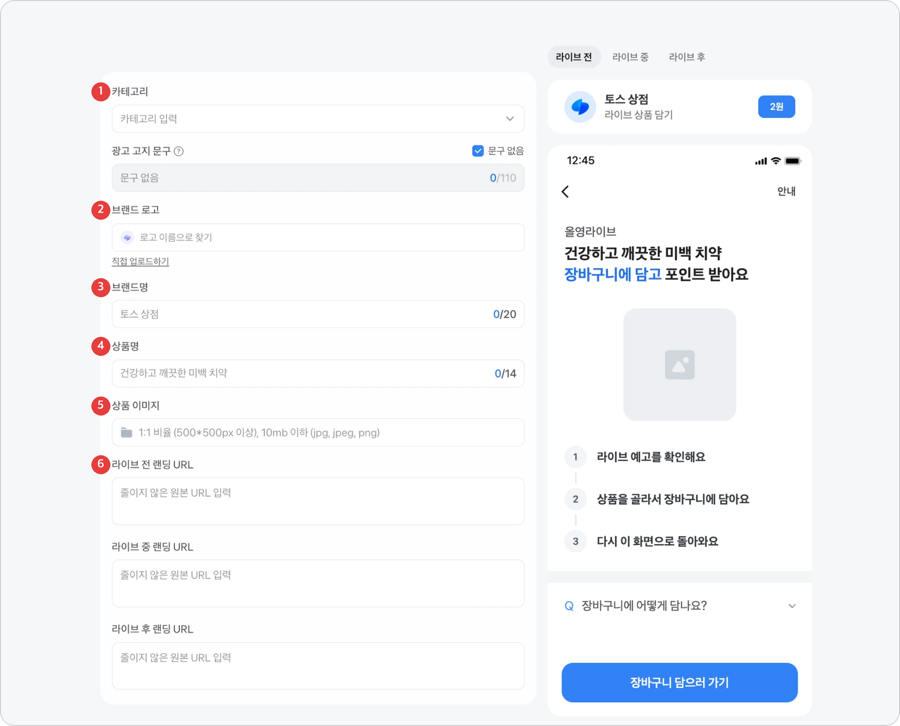

---
layout:
  width: default
  title:
    visible: true
  description:
    visible: false
  tableOfContents:
    visible: true
  outline:
    visible: true
  pagination:
    visible: true
  metadata:
    visible: true
  tags:
    visible: true
  actions:
    visible: true
  anchors:
    visible: true
---

# 소재 가이드

### 소재 심사 제출 

일주일 방문 미션(협력광고)은 집행 당일 소재를 만들 수 없어요.

심사를 완료한 소재만 광고를 집행할 수 있어요.


원활한 광고 집행을 위해 집행일 기준 2\~3영업일 전에 소재를 제출해 주세요.

* 소재는 평일 오전 10시부터 오후 7시까지, 심사 신청 순서대로 심사해요.
* 가이드에 맞지 않아 반려되면 광고 집행 전까지 승인되지 않을 수 있어요.
* 광고 집행 전날 21:00 이후 심사가 끝나면 예산을 다 쓰지 못할 수 있어요.
* 라이브 상품 담기는 라이브 당일에 소재를 등록할 수 없어요. 라이브 전날까지 제출해 주세요.


**소재 수정**

* 집행일이 지나지 않은 캠페인은 \[반려] 상태에서도 수정할 수 있어요.
* \[심사 중], \[승인] 상태이거나 캠페인이 \[집행 예정], \[집행 중], \[집행 완료], \[집행 중단] 상태이면 수정할 수 없어요.
* 심사 승인 이후 집행을 중단하려면 소재 탭에서 소재 토글을 OFF해 주세요.
  * 캠페인을 누른 뒤 노출 상태 토글을 OFF로 바꿔 주세요.
  * OFF 이후 미집행 금액은 캠페인 종료 후 환불돼요.
  * 소재를 OFF하기 전에 사용자가 미션을 완료했다면 일부 금액이 추가로 과금될 수 있어요.

***

### **필요한 정보** 

<figure><figcaption></figcaption></figure>

| 광고 소재                   | 상품 구경하기 | 상품 담기 | 상품 좋아요 누르기 | 라이브 상품 담기 |
| ----------------------- | ------- | ----- | ---------- | --------- |
| 1. 브랜드 로고 이미지           | ✓       | ✓     | ✓          | ✓         |
| 2. 브랜드명                 | ✓       | ✓     | ✓          | ✓         |
| 3. 상품명                  | ✓       | ✓     | ✓          | ✓         |
| 4. 상품 이미지               | ✓       | ✓     | ✓          | ✓         |
| 5. 랜딩 페이지 url           | ✓       | ✓     | ✓          |           |
| 6. 라이브 일시               |         |       |            | ✓         |
| 7. 라이브 전·중·후 랜딩 페이지 url |         |       |            | ✓         |

### 소재 만들기 


[**소재 심사 규정**](https://toss-ads.gitbook.io/guide/policy/creativeguide)**을 반드시 확인해 주세요.**

* 집행할 수 없는 상품
  * 일주일 방문 미션(협력광고)은 연령 타겟을 설정할 수 없어, 토스애즈 청소년 보호정책에 해당하는 상품은 심사 단계에서 승인할 수 없어요.
    * 성형, 미용 시술, 신체 변형, 다이어트(체중 감량) 및 이와 관련 있다고 판단되는 제품, 서비스
      * 예시) 체지방 감소 건강기능식품, 다이어트 보조 식품 등
    * 연애, 결혼, 데이트 서비스 및 이와 관련 있다고 판단되는 제품, 서비스
    * 그 외 [토스애즈 청소년 보호정책](https://toss-ads.gitbook.io/guide/review/basicguide#minor-protection)에 해당하는 제품, 서비스


1. **소재 추가**
   * 왼쪽 목록에서 캠페인 이름 옆의 소재 추가를 누르면 그 캠페인 아래에 새 소재가 생겨요.
2. **소재 선택**
   * 새로 만든 소재가 왼쪽 목록에서 선택되고, 오른쪽에 소재 정보를 입력하는 화면이 열려요.
3. **소재명**
   * 소재 이름을 입력하는 영역이에요. 100자까지 입력할 수 있어요.
     * 소재명은 기본값 '소재\_연월일시'로 자동 생성되고 수정할 수 있어요.
4. **소재 유형**
   * 소재 유형마다 브릿지 페이지에서 보여 주는 화면과 단가가 달라요.
     * **상품 구경하기** : 단가 20원
     * **상품 담기**, **라이브 상품 담기**, **좋아요 누르기** : 단가 30원
5. **집행 기간**
   * 소재마다 캠페인과 동일한 집행 기간 또는 별도로 직접 설정할 수 있어요.
   * 직접 설정하면 하루 단위로 최소 하루부터 최대 2주까지 선택할 수 있어요.
     * 오늘과 지난 날짜는 선택할 수 없고 다음 날부터 선택할 수 있어요.
     * 캠페인 기간보다 이전, 이후의 날짜는 선택할 수 없어요.
6. **라이브 일시**
   * 라이브 상품 담기를 선택하면 입력할 수 있어요.
   * 올리브영에 예약된 라이브 날짜와 시작·종료 시각을 그대로 입력해 주세요.
   * 라이브 날짜는 집행 기간 안에서 하루만 선택할 수 있어요. 자정을 넘기는 방송은 등록할 수 없어요.
   * 시각은 00:00부터 23:59까지 시와 분으로 입력해요. 종료 시각은 시작 시각보다 1분 이상 늦어야 해요.
7. **일 예산**
   * 5만 원 이상 1억 원 이하로 입력할 수 있어요.
     * 100원 단위로 입력해야 해요.
     * 일 예산을 입력하면 예상되는 목표 미션 완료 수를 보여 줘요.

***

1. **카테고리 및 광고 고지 문구**
   * 광고 고지 문구(심의필)는 화면 하단에 위치한 행동 유도 버튼 위쪽에 표시돼요.
     * 카테고리에 따라 소재를 제출할 때 광고 고지 문구를 함께 입력해야 해요.
       * 자세한 내용은 [**업종별 심사 가이드**](https://toss-ads.gitbook.io/guide/policy/industryguide)에서 확인할 수 있어요.

<figure><figcaption></figcaption></figure>

2. **브랜드 로고 이미지**
   * 1:1 비율 400\*400px 이상, 크기 10MB 이하의 png, jpg, jpeg 형식의 이미지를 등록해 주세요.
   * 로고만 삽입된 정사각형 이미지를 사용해 주세요.
     * 제품 이미지 및 기획전 이미지는 사용할 수 없어요.
   * 강한 형광색 배경은 사용할 수 없어요.
   * 테두리가 포함된 이미지는 사용할 수 없어요.
3. **브랜드명**
   * 공백 포함 최대 20자까지 입력할 수 있어요.
   * 브랜드명이 담긴 홍보 문구를 쓸 수 있어요.
     * 예시) 토스쇼핑 특가상품, 토스쇼핑 특별전
     * 홍보 문구는 랜딩 페이지에서 확인할 수 있는 정보여야 해요.
4. **상품명**
   * 공백 포함 최대 14자까지 입력할 수 있어요.
   * 랜딩 페이지와 상품명이 일치하지 않더라도 주요 키워드가 포함되어있으면 사용할 수 있어요.
5.  **상품 이미지**

    * 배경색이 포함된 1000\*1000px의 jpg, jpeg, png 형식의 이미지를 등록해 주세요.
    * 상품의 특징이 한눈에 잘 보이는 이미지로 등록해 주세요.
    * 모서리가 둥글지 않은 정사각형 이미지로 등록해 주세요.
    * 투명 배경, 강한 형광색, 토스의 배경 색상과 같은 컬러의 배경 이미지는 사용할 수 없어요.
    * 테두리가 있는 이미지는 사용할 수 없어요.
    * 주요 제품을 강조하기 위해 최대한 가운데에 배치하여 구성해 주세요.
    * 컬러 테두리가 있거나 작게 분할되어 3개 이상 복잡한 오브젝트로 구성된 이미지는 사용할 수 없어요.
      * 가독성을 위해 엠블럼은 최대 2개까지만 사용할 수 있어요.

    ※ 이미지 내 텍스트는 가독성을 위해 사용을 지양해 주세요.

    * 글자를 꼭 넣어야 한다면 배경이나 다른 요소에 가려지지 않게 넣어 주세요.
6. **랜딩 페이지 url**
   * 올리브영 상품 상세 페이지나 라이브 사전 예고 페이지를 등록할 수 있어요. 라이브 상품 담기는 라이브 페이지도 등록할 수 있어요.
     * **상품 상세 페이지**
       * utm은 자동으로 생성되기 때문에 상품 상세 페이지 url만 넣어 주세요.
     * **라이브 사전 예고 페이지**
       * 라이브 당일 예고 페이지 url은 소재로 등록할 수 없어요.
         * 예시) 26년 8월 1일에 라이브 방송을 진행하는 상품이라면 26년 7월 31일까지만 소재로 등록할 수 있어요.
     * **라이브 상품 담기**
       * 랜딩 페이지 url 대신 라이브 전·중·후 랜딩 url 3개를 칸마다 하나씩 입력해요. 칸마다 입력할 수 있는 url 형식이 달라요.
       * 입력한 라이브 일시에 따라 사용자가 이동하는 페이지가 바뀌어요.
         * 라이브 시작 10분 전까지는 라이브 전 랜딩 페이지(예고 페이지)로 이동해요.
         * 라이브 시작 10분 전부터 종료 5분 후까지는 라이브 중 랜딩 페이지로 이동해요.
         * 라이브 종료 5분 후부터는 라이브 후 랜딩 페이지(상품 상세 페이지)로 이동해요.
       * 광고는 집행 기간 내내 노출되고, 라이브 시간에 따라 이동하는 페이지만 바뀌어요.
       * 소재 미리보기 위쪽의 라이브 전, 라이브 중, 라이브 후 탭을 누르면 시점별로 사용자가 보는 화면을 확인할 수 있어요.

***

> **링크 작성 가이드**

* utm은 자동으로 생성되기 때문에 아래 형식으로만 제출해 주세요.
  * 링크가 가이드 형식과 다르면 광고를 집행할 수 없어요.
    * **올리브영 상품 상세 페이지**
      * `https://m.oliveyoung.co.kr/m/goods/getGoodsDetail.do?goodsNo=상품번호`
    * **라이브 사전 예고 페이지**
      * `https://m.oliveyoung.co.kr/m/mtn/liveshop/teasers/예고ID`
    * **라이브 상품 담기**
      * 라이브 전: `https://m.oliveyoung.co.kr/m/mtn/liveshop/teasers/예고ID`
      * 라이브 중: `https://m.oliveyoung.co.kr/m/live/broadcast/gate.do?resvId=예약ID`
      * 라이브 후: `https://m.oliveyoung.co.kr/m/goods/getGoodsDetail.do?goodsNo=상품번호`
      * 라이브 중 랜딩 url은 꼭 `gate.do` 형식으로 입력해 주세요. `live.do` 링크는 등록할 수 없어요.
      * 라이브가 끝나면 예고 페이지와 라이브 페이지에 들어갈 수 없어요. 라이브 후 랜딩 url에는 라이브의 대표 상품 상세 페이지를 입력해 주세요.

> **랜딩 페이지 심사 규정**

* 올리브영 상품 상세 페이지나 라이브 사전 예고 페이지로만 집행할 수 있어요. 단, 라이브 상품 담기는 라이브 페이지로도 집행할 수 있어요.
* 라이브 상품 담기는 예고 페이지에 적힌 라이브 날짜가 소재에 입력한 라이브 일시와 같아야 해요.
* 광고 소재 내용과 랜딩 페이지 내용이 **서로 다르면 광고를 집행할 수 없어요**.
* 랜딩 페이지에서 정보를 바로 확인할 수 있어야 해요.
* 랜딩 페이지에 유저가 상품·이벤트·프로모션을 문의할 수 있는 문의처가 적혀 있어야 해요.
* 공식 제휴 광고가 아니라면 '토스'의 브랜드명·서비스명은 사용할 수 없어요.
  * 내부 협의를 마쳤다면 증빙 자료를 제출해 주세요.
* 저작권 침해 등 이슈가 생길 수 있는 소재는 집행할 수 없어요.
